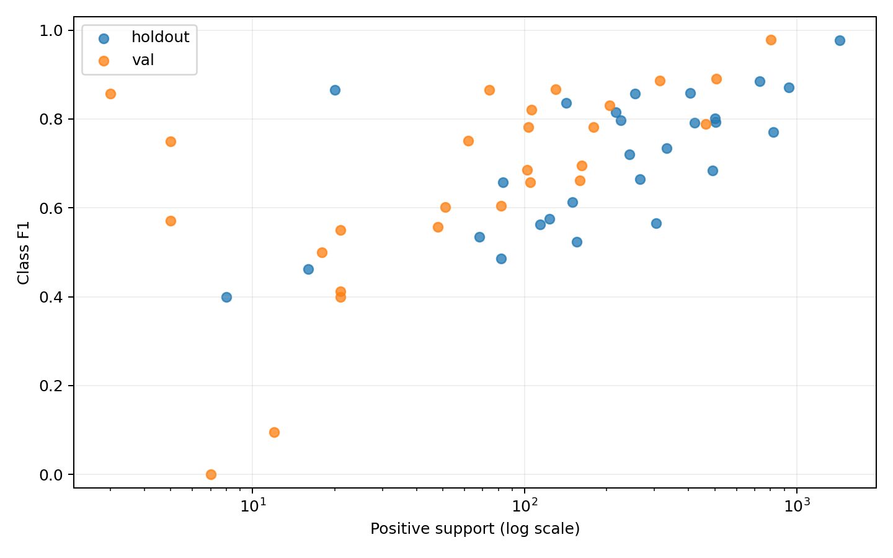

# ConvNeXt-Tiny 클래스별 약점 및 과적합 분석

## 분석 근거와 제한

- 저장된 best epoch 10의 holdout/공식 val logits와 정답을 CPU에서 재계산했다. threshold 0.5(동일하게 logits≥0)를 유지했다. 기존 클래스별 CSV의 27개 클래스 모든 수치와 일치했다.
- 공식 val은 보고용으로만 사용했다. threshold/하이퍼파라미터 변경, 재추론, 추가 학습은 실행하지 않았다.
- 클래스별 support는 해당 클래스를 가진 이미지 수다. 다중 라벨이므로 합계는 이미지 수와 다르다. Macro F1은 정답 없는 클래스도 포함한 27개 평균이다.
- 표본 구간 0/1~9/10~49/50+는 기술적 비교를 위한 기준이며 통계적 유의성 기준은 아니다. 정답 수는 평가셋 표본 수이므로 학습셋의 희소성을 직접 증명하지 않는다.

## 전체 성능

|분할|이미지|Micro F1|Macro F1|Image F1|정답 있는 클래스만 Macro|
|---|---:|---:|---:|---:|---:|
|holdout|2425|0.805435|0.707369|0.809035|0.707369|
|val|1158|0.825538|0.660754|0.827740|0.660754|

## holdout 성능 하위 8개

|클래스|정답 수|Precision|Recall|F1|TP|FP|FN|
|---|---:|---:|---:|---:|---:|---:|---:|
|leg warmer|8|1.0000|0.2500|0.4000|2|0|6|
|cape|16|0.6000|0.3750|0.4615|6|4|10|
|vest|82|0.5862|0.4146|0.4857|34|24|48|
|sock|155|0.6000|0.4645|0.5236|72|48|83|
|jumpsuit|68|0.8182|0.3971|0.5347|27|6|41|
|cardigan|114|0.6923|0.4737|0.5625|54|24|60|
|watch|304|0.6524|0.5000|0.5661|152|81|152|
|sweater|123|0.7600|0.4634|0.5758|57|18|66|

정답 없는 클래스: 없음. 정답 0인 클래스는 recall을 0으로 표시하는 공통 정의를 따르며 성능의 일반화 추정이 불가능하다.

## val 성능 하위 8개

|클래스|정답 수|Precision|Recall|F1|TP|FP|FN|
|---|---:|---:|---:|---:|---:|---:|---:|
|leg warmer|7|0.0000|0.0000|0.0000|0|0|7|
|cardigan|12|0.1111|0.0833|0.0952|1|8|11|
|jumpsuit|21|0.6667|0.2857|0.4000|6|3|15|
|vest|21|0.5385|0.3333|0.4118|7|6|14|
|glove|18|0.7000|0.3889|0.5000|7|3|11|
|sweater|21|0.5789|0.5238|0.5500|11|8|10|
|scarf|48|0.7097|0.4583|0.5570|22|9|26|
|cape|5|1.0000|0.4000|0.5714|2|0|3|

정답 없는 클래스: 없음. 정답 0인 클래스는 recall을 0으로 표시하는 공통 정의를 따르며 성능의 일반화 추정이 불가능하다.

## 표본 수와 낮은 성능의 관계

|분할|구간|클래스 수|정답 합계|평균 F1|
|---|---|---:|---:|---:|
|holdout|정답 없음|0|0||
|holdout|희소 1~9|1|8|0.4000|
|holdout|소수 10~49|2|36|0.6632|
|holdout|다수 50 이상|24|8998|0.7239|
|val|정답 없음|0|0||
|val|희소 1~9|4|20|0.5446|
|val|소수 10~49|6|141|0.4190|
|val|다수 50 이상|17|3606|0.7734|

support와 F1의 기술적 Spearman 상관: holdout=0.634, val=0.671. 27개 클래스 수준의 관찰이며 인과관계가 아니다. 희소 클래스에서는 TP 1개 변화만으로 recall/F1이 크게 바뀐다. 다수 클래스의 낮은 F1은 단순 표본 부족으로 설명할 수 없으므로 FP/FN 패턴을 별도로 봐야 한다.

## 공식 val Macro F1 하락의 분해

val−holdout Macro F1=-0.046615. 각 클래스 ΔF1/27을 합하면 정확히 이 차이가 된다. 이미지 수 차이(2425 대 1158)만으로 성능 저하를 단정할 수는 없다.

|클래스|Holdout 정답|Val 정답|Holdout F1|Val F1|ΔF1|Macro 기여|
|---|---:|---:|---:|---:|---:|---:|
|cardigan|114|12|0.5625|0.0952|-0.4673|-0.01731|
|leg warmer|8|7|0.4000|0.0000|-0.4000|-0.01481|
|glove|83|18|0.6569|0.5000|-0.1569|-0.00581|
|jumpsuit|68|21|0.5347|0.4000|-0.1347|-0.00499|
|umbrella|20|5|0.8649|0.7500|-0.1149|-0.00425|
|shirt, blouse|421|102|0.7916|0.6848|-0.1068|-0.00395|
|vest|82|21|0.4857|0.4118|-0.0739|-0.00274|
|scarf|150|48|0.6122|0.5570|-0.0553|-0.00205|
|tights, stockings|225|62|0.7968|0.7517|-0.0451|-0.00167|
|skirt|332|162|0.7337|0.6954|-0.0384|-0.00142|

확인된 사실: 위 클래스별 지표 차이와 정답 수 차이가 Macro 차이를 구성한다. 클래스별 prevalence도 CSV에 함께 저장했다. 가설: 희소 클래스의 추정 변동, 이미지/포즈/의복 구성의 분포 차이, 주석 경계 차이가 영향을 줬을 수 있다. 학습 데이터의 클래스별 표본 및 독립적인 주석 검토 없이 이를 원인으로 확정할 수 없다.

## FP·FN 동시 발생 및 기존 이미지 사례

FP 클래스와 FN 클래스가 같은 이미지에서 함께 발생한 횟수다. 다중 라벨이므로 범주형 confusion matrix나 일대일 오분류 수와 같지 않다.

### holdout 주요 동시 오류
- FP `dress` + FN `top, t-shirt, sweatshirt`: 66장
- FP `dress` + FN `skirt`: 53장
- FP `top, t-shirt, sweatshirt` + FN `shirt, blouse`: 46장
- FP `top, t-shirt, sweatshirt` + FN `dress`: 45장
- FP `top, t-shirt, sweatshirt` + FN `sweater`: 36장
- [기존 사례 1](local_snapshot/실험결과/error_examples/holdout/example_01.jpg), 원본명 `12a77371e66cf04d40d3529d2333ef9e.jpg`: FP=["dress", "bag, wallet"], FN=["shirt, blouse", "jacket", "pants", "glasses", "tie", "shoe", "scarf"]. 이 링크의 이미지와 저장된 정답/예측을 연결한 기록이다.
- [기존 사례 2](local_snapshot/실험결과/error_examples/holdout/example_02.jpg), 원본명 `e00460796724c066809d1b010cf8abd1.jpg`: FP=["shirt, blouse", "jacket", "pants", "glasses", "tie"], FN=["dress", "bag, wallet", "scarf"]. 이 링크의 이미지와 저장된 정답/예측을 연결한 기록이다.
- [기존 사례 3](local_snapshot/실험결과/error_examples/holdout/example_03.jpg), 원본명 `68655c8016332859bd6947d191c631f6.jpg`: FP=["dress"], FN=["shirt, blouse", "jacket", "pants", "tie", "shoe"]. 이 링크의 이미지와 저장된 정답/예측을 연결한 기록이다.
- [기존 사례 4](local_snapshot/실험결과/error_examples/holdout/example_04.jpg), 원본명 `28744e416e20c190109942cbda14347a.jpg`: FP=["dress", "tights, stockings"], FN=["pants", "coat", "headband, head covering, hair accessory"]. 이 링크의 이미지와 저장된 정답/예측을 연결한 기록이다.

### val 주요 동시 오류
- FP `dress` + FN `top, t-shirt, sweatshirt`: 50장
- FP `dress` + FN `skirt`: 33장
- FP `top, t-shirt, sweatshirt` + FN `dress`: 18장
- FP `top, t-shirt, sweatshirt` + FN `shirt, blouse`: 17장
- FP `skirt` + FN `dress`: 13장
- [기존 사례 1](local_snapshot/실험결과/error_examples/val/example_01.jpg), 원본명 `20bdefcd48f74c927cca2870e52176b1.jpg`: FP=["coat", "scarf"], FN=["jacket", "dress", "tights, stockings"]. 이 링크의 이미지와 저장된 정답/예측을 연결한 기록이다.
- [기존 사례 2](local_snapshot/실험결과/error_examples/val/example_02.jpg), 원본명 `86f139c6fe14c64090091230a78862fd.jpg`: FP=["jacket", "dress"], FN=["top, t-shirt, sweatshirt", "skirt", "shoe"]. 이 링크의 이미지와 저장된 정답/예측을 연결한 기록이다.
- [기존 사례 3](local_snapshot/실험결과/error_examples/val/example_03.jpg), 원본명 `24f1db5265b04819c05c271ffb22a0ef.jpg`: FP=["sweater", "coat"], FN=["top, t-shirt, sweatshirt", "jacket"]. 이 링크의 이미지와 저장된 정답/예측을 연결한 기록이다.
- [기존 사례 4](local_snapshot/실험결과/error_examples/val/example_04.jpg), 원본명 `292ebab1191c45465fddac3b9612f4f2.jpg`: FP=["dress", "bag, wallet"], FN=["top, t-shirt, sweatshirt", "pants"]. 이 링크의 이미지와 저장된 정답/예측을 연결한 기록이다.

시각 확인: 두 contact sheet의 총 24개 오류 이미지를 확인했다. holdout 앞 3개에는 여러 사람이 함께 등장하고, val 1·2번은 앉은 자세이며 val 3번은 상체 중심으로 잘려 있다. 이러한 구도는 작은 의복·가려진 부위 판단을 어렵게 할 수 있다는 가설을 제시하지만, 모델의 실제 원인이라고 입증하지는 않는다. `dress`와 `top/skirt/pants` 등의 경계가 외관상 애매한 사례도 있어, 저장된 주석을 시각 판단만으로 오류라고 단정하거나 수정하지 않았다. 기존 12개 시트는 최저 Image F1 순으로 고른 편향된 사례이므로 클래스 전체의 대표 표본은 아니다.

## 과적합과 best/early stopping 해석

|Epoch|Train BCE|Holdout BCE|Holdout Macro F1|
|---:|---:|---:|---:|
|1|0.181583|0.161568|0.505908|
|2|0.104167|0.148213|0.621070|
|3|0.077381|0.139571|0.652264|
|4|0.054579|0.149622|0.673166|
|5|0.036744|0.179781|0.681589|
|6|0.024902|0.189953|0.680776|
|7|0.017522|0.220763|0.675791|
|8|0.013345|0.244973|0.688495|
|9|0.010251|0.257151|0.674915|
|10|0.009334|0.252751|0.707369|
|11|0.006912|0.268976|0.694057|
|12|0.005782|0.293991|0.680646|
|13|0.005074|0.296287|0.699709|
|14|0.004324|0.301396|0.692096|
|15|0.002751|0.321645|0.696809|

- Train BCE는 계속 감소하지만 holdout BCE는 초반 최저점 이후 상승한다. 이는 일부 틀린 예측의 과도한 확신/확률 보정 악화를 포함한 과적합 징후와 일치한다. 확정적인 원인 판별에는 추가 검사가 필요하다.
- BCE는 모든 이미지×클래스의 연속 확률과 확신의 정도를 평가한다. F1은 고정 threshold 0.5의 이산 판정과 TP/FP/FN을 평가한다. 따라서 소수의 고확신 오답이 BCE를 크게 올리는 동안 일부 클래스가 threshold를 올바르게 넘으면 F1은 개선될 수 있다. 다중 라벨·클래스 불균형에서는 두 지표의 가중 방식도 다르다.
- best epoch 10은 holdout Macro F1=0.707369가 최대였기 때문에 선택했다. holdout BCE 최저 epoch를 선택하는 실험이 아니었다. epoch 11~15에서 해당 Macro F1을 넘지 못한 5회 연속 미개선으로 epoch 15에서 early stopping했다. 공식 val은 이 선택에 사용하지 않았다.

## 후속 실험 후보 — 제안만, 실행하지 않음

- 내부 holdout/추가 내부 CV에서 weight decay·학습률·학습 길이를 비교하고 확률 보정(BCE, calibration)을 함께 기록한다.
- 학습셋 클래스별 support를 먼저 조사한 뒤 희소 클래스 손실 가중/샘플링을 별도 대조 실험으로 검토한다.
- 혼동이 큰 의복 경계에 대한 주석 점검과 ROI/해상도 대조를 제안한다. 현재 실험의 증강·threshold·정규화는 변경하지 않는다.
- 클래스별 threshold나 calibration을 검토하더라도 내부 holdout으로만 선택하고, 공식 val은 잠근 최종 평가로 유지한다.

## 비용 단위와 재현성

- 파라미터 27,840,891; 누적 학습 58.97분.
- 최대 allocated: 3,652,414,976 bytes = 3.652415 GB = 3.401577 GiB.
- 최대 reserved: 3,735,027,712 bytes = 3.735028 GB = 3.478516 GiB.
- GB=10^9 bytes, GiB=2^30 bytes. 기존 팀 CSV max_vram_gb는 allocated/10^9이며 reserved 또는 nvidia-smi 전체 점유와 혼동하지 않는다.
- CUBLAS_WORKSPACE_CONFIG 미설정 결정성 경고가 기록됐으므로 비트 단위 재현은 보장하지 않는다.
- 원본 이미지 데이터는 이번 백업에 포함하지 않고, 기존 오류 예시만 보존한다.

## 다수 표본 클래스와 구체적 사례 보충

- `sock`: val support=51, F1=0.6022, FP=14, FN=23. 단순히 극소 표본 클래스만의 문제로 볼 수 없다.
- `watch`: val support=82, F1=0.6043, FP=15, FN=40. 단순히 극소 표본 클래스만의 문제로 볼 수 없다.
- `headband, head covering, hair accessory`: val support=105, F1=0.6571, FP=36, FN=36. 단순히 극소 표본 클래스만의 문제로 볼 수 없다.
- `belt`: val support=159, F1=0.6623, FP=47, FN=57. 단순히 극소 표본 클래스만의 문제로 볼 수 없다.

주요 클래스별 FP/FN 최대 3개씩의 원본 파일명·예측확률·기존 이미지 링크는 `주요클래스_FP_FN_사례.csv`에 저장했다. 이미지가 보관된 사례를 우선 연결했으며, 이미지가 없는 희소 클래스 사례에는 시각적 원인을 해석하지 않았다고 표시했다.

- `vest` FN, p=0.0146: [f4c8049f436b7edcb26c01d3219e14c2.jpg](local_snapshot/실험결과/error_examples/val/example_06.jpg)
- `dress` FP, p=0.9999: [292ebab1191c45465fddac3b9612f4f2.jpg](local_snapshot/실험결과/error_examples/val/example_04.jpg)
- `dress` FP, p=0.9999: [fac06865b4cba1c6f61a48a75848b626.jpg](local_snapshot/실험결과/error_examples/val/example_07.jpg)
- `dress` FP, p=0.9992: [95bca399ad3d4296c61863dadc45c82e.jpg](local_snapshot/실험결과/error_examples/val/example_11.jpg)
- `dress` FN, p=0.0007: [20bdefcd48f74c927cca2870e52176b1.jpg](local_snapshot/실험결과/error_examples/val/example_01.jpg)
- `dress` FN, p=0.0095: [734203a8661cedf46872cb8f86998fe7.jpg](local_snapshot/실험결과/error_examples/val/example_10.jpg)
- `dress` FN, p=0.2093: [05ac586e0bd29fdf12a9506bf05b280b.jpg](local_snapshot/실험결과/error_examples/val/example_08.jpg)
- `jacket` FP, p=0.5821: [86f139c6fe14c64090091230a78862fd.jpg](local_snapshot/실험결과/error_examples/val/example_02.jpg)

val 1~9개 그룹 평균 F1(0.5446)이 10~49개 그룹(0.4190)보다 높으므로 표본 수와 성능의 단조 관계나 표본 부족만의 원인론은 성립하지 않는다. 다수 그룹 평균은 0.7734다.

## 서버 원본 로그 대조와 누락 사항

원본 history.csv/history.json의 1~15 epoch 값은 모두 일치한다. continuation.log/gpu3.log/gpu0.log의 본학습 완료 문장은 14개 epoch에서 반올림 오차 1e-6 이내로 일치했다. GPU 이동 직전 epoch 8의 console 완료 문장은 보존 로그에 없어 직접 대조하지 못했으나, 해당 epoch의 CSV/JSON 기록은 모두 보존돼 있다. smoke epoch 1 문장은 제외했다. 공통 코드 및 고정 split의 로컬·서버 보관본 해시도 일치한다. 세부 증거는 원본로그_공통코드_검증.json에 있다.
