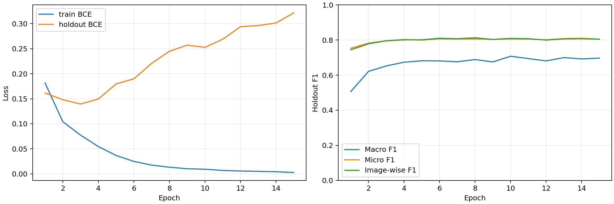
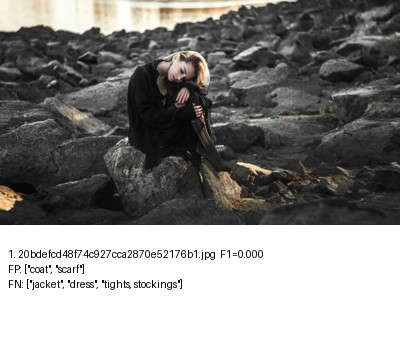
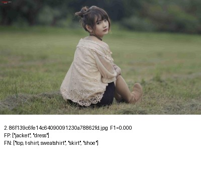
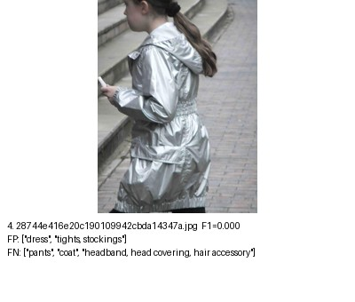
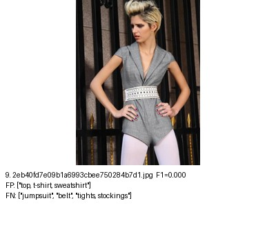

# S2 ConvNeXt-Tiny 팀 공유 실험 보고서

작성일: 2026-11-03 | 담당: 이정은 | 검증된 로컬 백업 자료 기준

## ConvNeXt-Tiny 기준 실험 보고서

이 실험은 27개 의류·액세서리를 동시에 예측하는 다중 라벨 분류의 기준점이다. 다른 모델·손실함수 실험과 같은 조건으로 비교할 수 있는 재현 가능한 베이스라인을 만드는 것이 목적이다. 학습에 쓰지 않고 모델 선택에 사용하는 내부 검증셋을 holdout이라 부른다. 현재 자료만으로 다른 모델보다 우수하다고 판단하지 않는다.

### 공식 val 최종 성능

| Micro F1 | Macro F1 | Image-wise F1 |
| --- | --- | --- |
| 0.82554 | 0.66075 | 0.82774 |

F1은 정밀도(예측한 양성 중 정답 비율)와 재현율(실제 양성 중 찾은 비율)의 조화평균이며 정확도와 다르다. Micro는 TP(맞게 찾은 양성)·FP(잘못 추가한 라벨)·FN(놓친 라벨)을 전체 클래스에서 합산하고, Macro는 27개 클래스 F1을 동일 가중 평균한다. Image-wise는 이미지별 F1의 평균이다.

### 어떤 모델을 선택했는가

| 항목 | 확인된 결과 |
| --- | --- |
| 모델 | ConvNeXt-Tiny, ImageNet-22k 사전학습 후 1k 미세조정 체크포인트 |
| 체크포인트 선택 | 내부 holdout Macro F1이 최대인 epoch 10 |
| 학습 종료 | epoch 15, 5회 연속 Macro F1 미개선으로 조기 종료(early stopping) |
| 규모·실행 | 27,840,891개 파라미터 / 유효 배치 32 / GPU 0에서 최종 완료 |

### 주요 약점과 결론

공식 val의 leg warmer는 정답 7개를 모두 놓쳐 F1=0이고, cardigan은 정답 12개에서 TP=1·FP=8·FN=11로 F1=0.0952다. 두 클래스의 하락은 holdout 대비 val Macro F1 차이에 크게 기여한다. 평가 표본이 적다는 사실을 학습 데이터 부족의 증거로 단정하지 않는다.

학습 손실인 BCE(이진 교차 엔트로피)는 계속 감소하지만 holdout 손실은 상승해 과적합·확률 보정 악화 징후가 보인다. 그럼에도 고정 임계값(threshold)에서의 Macro F1은 epoch 10까지 개선됐다. 이 결과는 “최소 BCE 모델”이 아니라 “최대 holdout Macro F1 모델”의 최종 보고다.

검증 상태: 예측 NPZ 재계산 지표 일치, best/last 가중치 원본·백업 SHA-256 일치, 로컬 CPU strict 로드 통과. 추가 학습·재추론은 수행하지 않았다.

<!-- pagebreak -->

## 실험 구성과 공정한 비교 조건

ConvNeXt-Tiny 사전학습 특징을 활용하고 마지막 분류기를 27개 출력으로 바꿨다. GAP는 공간별 특징을 평균하는 연산이다. 실제 timm 헤드는 GAP → LayerNorm(특징 정규화) → Linear(768→27)이다. Linear는 선형 분류기이며 숨은 MLP(다층 신경망)는 없다. 출력은 sigmoid 적용 전 원시 점수인 logits다. 설정의 gap_linear_27이라는 축약명보다 이 실제 구조를 우선한다.

| 구분 | 실제 적용 내용 |
| --- | --- |
| 체크포인트 | convnext_tiny.fb_in22k_ft_in1k_384 / pretrained=True |
| 헤드·출력 | GAP → LayerNorm → Linear(768→27), logits 출력, dropout=0 |
| 손실 | binary_cross_entropy_with_logits: BCEWithLogitsLoss와 동일 연산 |
| Optimizer | AdamW (가중치 감쇠를 분리한 Adam 계열 optimizer) |
| 초기 학습률 | backbone 1e-4 / Linear 분류기 weight·bias 1e-3 |
| Weight decay | 0.05, LayerNorm 등 Linear 외 파라미터는 backbone 그룹 |
| 입력·크기 | EXIF 방향 반영 후 RGB, 384×384 |
| 전처리 | 종횡비 유지 bicubic resize → 중앙 검정 padding → 정규화 |
| 정규화 | 체크포인트 mean=(0.485,0.456,0.406), std=(0.229,0.224,0.225) |
| 학습 증강 | 수평 반전 p=0.5만; 평가 증강 없음 |
| 배치·재현 기준 | batch 16 × gradient accumulation 2 = 유효 배치 32; seed 42 |
| 학습률 일정 | optimizer step 기준 cosine decay; 계획된 전체 step의 5% warmup |
| 최대·종료 | 최대 30 epoch / holdout Macro F1 patience 5 |
| 평가 기준 | sigmoid(logits) ≥ 0.5, threshold 고정 |

### 분할과 선택 절차

학습 원천 45,622장을 고정 목록으로 train_inner 43,197장과 holdout 2,425장으로 나눴다. 공식 val은 1,158장이다. train_inner/holdout의 중복·누락 및 val과의 파일명 겹침을 검사했고, 이미지와 라벨·27개 클래스 순서를 확인했다. 공개 test·예시 데이터는 사용하지 않았다.

Gradient accumulation은 여러 microbatch의 gradient를 모아 한 번 optimizer를 갱신하는 방법이다. 마지막 불완전 누적 구간도 실제 표본 수로 가중한다. AMP(혼합 정밀도)를 사용했고 overflow로 건너뛴 step은 scheduler를 진행하지 않았다. YAML 자동 적용을 가정하지 않고 실제 config.json과 CLI 옵션을 대조했다.

<!-- pagebreak -->

## 성능·비용과 학습 곡선

| 분할 | Micro F1 | Macro F1 | Image-wise F1 |
| --- | --- | --- | --- |
| Holdout | 0.805435 | 0.707369 | 0.809035 |
| 공식 val | 0.825538 | 0.660754 | 0.827740 |

학습 시간은 GPU 이동 전후 누적 train 구간 58.97분이다. 마지막 재개 프로세스 wall time 23.20분이나 전체 대기 포함 소요 시간과는 다르다. val 모델 forward는 2.666ms/장, 데이터 처리 포함은 4.392ms/장이다.

최대 학습 allocated VRAM은 3.652415 GB = 3.401577 GiB, reserved는 3.735028 GB = 3.478516 GiB다. GB=10^9 bytes, GiB=2^30 bytes이며 nvidia-smi의 GPU 전체 점유와는 다르다. RTX A5000 공유 GPU에서 측정했고 0/3번 사이 이동이 있었으므로, 다른 실험과 시간 비교 시 동시 작업·배치·AMP·I/O·측정 범위를 확인해야 한다.

| Epoch | Train BCE | Holdout BCE | Holdout Macro F1 |
| --- | --- | --- | --- |
| 3 | 0.077381 | 0.139571 | 0.652264 |
| 10 | 0.009334 | 0.252751 | 0.707369 |
| 15 | 0.002751 | 0.321645 | 0.696809 |

BCE(이진 교차 엔트로피)는 각 라벨의 확률과 확신 정도를 연속적으로 평가한다. 반면 F1은 threshold 0.5를 넘었는지에 따른 이산 판정이다. 일부 고확신 오답이 BCE를 크게 높이는 동시에 다른 클래스의 판정이 개선되면 F1도 개선될 수 있다. 두 지표가 서로 모순되는 것은 아니다.

epoch 3은 holdout BCE가 가장 낮지만 Macro F1은 0.652264였다. 사전에 정한 선택 지표는 BCE가 아닌 holdout Macro F1이므로 최대 0.707369를 기록한 epoch 10을 best로 선택했다. epoch 11~15가 이를 넘지 못한 5회 연속 미개선으로 epoch 15에 종료했다. 공식 val은 이 선택·threshold 조정에 사용하지 않았다.

<!-- pagebreak -->

## 클래스별 약점과 분할 간 차이

TP는 맞게 찾은 양성, FP는 없는 라벨을 있다고 한 경우, FN은 있는 라벨을 놓친 경우다. Support는 그 클래스를 가진 정답 이미지 수이며 다중 라벨이므로 클래스별 합계가 이미지 수와 다르다. 두 분할 모두 정답 0인 클래스는 없고 Macro는 전체 27개 평균이다.

| 공식 val 클래스 | 정답 | P | R | F1 | TP/FP/FN |
| --- | --- | --- | --- | --- | --- |
| leg warmer | 7 | 0.000 | 0.000 | 0.000 | 0/0/7 |
| cardigan | 12 | 0.111 | 0.083 | 0.095 | 1/8/11 |
| jumpsuit | 21 | 0.667 | 0.286 | 0.400 | 6/3/15 |
| vest | 21 | 0.538 | 0.333 | 0.412 | 7/6/14 |
| glove | 18 | 0.700 | 0.389 | 0.500 | 7/3/11 |
| sweater | 21 | 0.579 | 0.524 | 0.550 | 11/8/10 |
| scarf | 48 | 0.710 | 0.458 | 0.557 | 22/9/26 |

### Macro F1 하락을 설명하는 직접적인 수치

| 클래스 | H/V 정답 수 | H F1 | V F1 | ΔF1/27 |
| --- | --- | --- | --- | --- |
| cardigan | 114/12 | 0.5625 | 0.0952 | -0.01731 |
| leg warmer | 8/7 | 0.4000 | 0.0000 | -0.01481 |
| glove | 83/18 | 0.6569 | 0.5000 | -0.00581 |
| jumpsuit | 68/21 | 0.5347 | 0.4000 | -0.00499 |

val−holdout Macro F1 차이는 -0.046615다. cardigan과 leg warmer의 합산 기여는 -0.032121로 순차이 크기의 약 68.9%다. 이는 27개 클래스 ΔF1/27의 산술 분해이며 인과적 설명이나 독립적인 효과 추정은 아니다. 다른 클래스의 상승·하락도 합계에 포함된다.

val support 구간별 평균 F1은 1~9개 0.5446(4클래스), 10~49개 0.4190(6클래스), 50개 이상 0.7734(17클래스)다. 희소 평가 표본은 지표 변동을 키우지만 표본 수와 성능은 단조 관계가 아니다. sock 51개/F1 0.6022, watch 82개/F1 0.6043처럼 상대적으로 표본이 많은 약점도 존재한다.

확인 사실은 클래스별 표본 수·라벨 비율·FP/FN·F1 차이다. 평가셋 support는 학습셋 support가 아니므로 이를 학습 데이터 부족의 증거로 쓰지 않는다. 분포 차이·의복 경계·가려짐·주석 기준의 영향은 가능한 가설이며 추가 검토 없이는 원인으로 확정할 수 없다. 전체 27개 지표는 별첨 CSV에 holdout/val 각 27행으로 제공한다.

<!-- pagebreak -->

## 대표 오류 사례 4개

사례는 보관된 최저 Image-wise F1 시트에서 골랐으며 전체 데이터의 대표 표본이 아니다. FP/FN은 저장된 정답 기준이다. 외관만으로 정답 주석을 수정하거나 주석 오류라고 단정하지 않는다.

### val / 20bdefcd48f74c927cca2870e52176b1.jpg

- 정답: [jacket] / [dress] / [tights, stockings]
- 예측: [coat] / [scarf]
- FP: [coat] / [scarf]
- FN: [jacket] / [dress] / [tights, stockings]
- 관찰과 가설: 앉은 자세와 어두운 의복이 보인다. 의복 경계·가려짐의 영향은 가설이다.

### val / 86f139c6fe14c64090091230a78862fd.jpg

- 정답: [top, t-shirt, sweatshirt] / [skirt] / [shoe]
- 예측: [jacket] / [dress]
- FP: [jacket] / [dress]
- FN: [top, t-shirt, sweatshirt] / [skirt] / [shoe]
- 관찰과 가설: 앉은 자세이며 상체를 덮는 천이 보인다. 겹침이 혼동 원인인지는 미확인이다.

### holdout / 28744e416e20c190109942cbda14347a.jpg

- 정답: [pants] / [coat] / [headband, head covering, hair accessory]
- 예측: [dress] / [tights, stockings]
- FP: [dress] / [tights, stockings]
- FN: [pants] / [coat] / [headband, head covering, hair accessory]
- 관찰과 가설: 뒤쪽/측면 자세의 광택 있는 의복이 보인다. 재질·구도 영향은 가설이다.

### holdout / 2eb40fd7e09b1a6993cbee750284b7d1.jpg

- 정답: [jumpsuit] / [belt] / [tights, stockings]
- 예측: [top, t-shirt, sweatshirt]
- FP: [top, t-shirt, sweatshirt]
- FN: [jumpsuit] / [belt] / [tights, stockings]
- 관찰과 가설: 한 벌 형태의 의복과 다리 일부가 보인다. top 대 jumpsuit 경계의 영향은 가설이다.

<!-- pagebreak -->

## 팀 활용·재현·검증 안내

### 비교 실험에 활용할 때

이번 결과는 다른 모델·손실함수와 비교할 베이스라인이다. 같은 train_inner/holdout 목록, 27개 클래스 순서, 공통 평가 코드, threshold 0.5, 공식 val 사용 원칙을 유지해야 한다. 학습 예산·seed·유효 배치·입력/증강·사전학습 범위도 함께 공개한다. 단일 seed 결과만으로 우열이나 통계적 유의성을 주장하지 않는다.

| 우선순위 | 후속 실험 후보 - 이번에는 실행하지 않음 |
| --- | --- |
| 1 | 같은 holdout에서 학습 길이·학습률·weight decay와 BCE/확률 보정 지표를 함께 비교 |
| 2 | 학습셋 클래스별 support를 조사한 뒤 희소 클래스 손실 가중·샘플링을 대조 실험 |
| 3 | 혼동 의복의 주석 기준 점검, ROI/해상도 대조; 현재 기준선 설정은 그대로 보존 |
| 조건 | threshold·calibration을 바꿀 경우 내부 데이터로만 선택, 공식 val은 최종 평가로 유지 |

### 재현 자료와 체크포인트

원본 공통 코드 SHA: c5827dfa749e276d4e5431628a06730b26c4841f. 개인 trainer는 공통 labels/dataset/preprocess/metrics를 재사용하며 원본은 보존했다. config.json을 실제로 읽고 CLI의 batch 16/accum 2를 적용했다. 원본 YAML이 자동으로 학습에 반영됐다고 가정하지 않았다.

원래 학습 환경은 Python 3.12.3, torch 2.8.0+cu126, torchvision 0.23.0+cu126, timm 1.0.22, NumPy 2.2.6, Pillow 11.3.0이다. 상세 버전·명령은 local_snapshot/실험결과/resolved_config.json, library_versions.json과 server_readonly_snapshot의 prep/requirements.freeze.txt에 있다.

백업 루트 기준: weights/best.pt(epoch 10), weights/last.pt(epoch 15); class_order.json; local_snapshot/실험결과/preds_holdout.npz·preds_val.npz; local_snapshot/코드_설정; server_readonly_snapshot/reference/.../common/splits. 전체 파일 경로·크기·SHA-256은 백업_파일목록.csv에 있다. 서버 원본 가중치는 /home/frostpine/fashion_tagging/experiments/role2_jeongeun_convnext/runs/S2_jeongeun_cnxt_t_bce_384_pad/에 보존돼 있다.

### 검증한 범위와 남는 한계

예측 NPZ 재계산과 기존 지표 일치, best/last 서버 원본 대비 SHA-256 일치, 로컬 CPU strict 로드 및 분류기 [27,768]·파라미터 수를 확인했다. 체크포인트는 전체 학습 상태 사전이며 모델은 checkpoint["model"]로 읽는다. pretrained=False로 구조만 만든 뒤 strict 로드하고 CPU에 둔다. load_model_cpu.py와 모델_로드방법.md가 제공된다. 이 검증은 로드·구조 확인이며 재추론 검증은 아니다.

원본 history CSV/JSON 15 epoch는 일치한다. console 로그는 14 epoch에서 대조됐고 GPU 이동 직전 epoch 8 완료 문장은 누락돼 직접 확인하지 못했다. CUBLAS_WORKSPACE_CONFIG 미설정 경고가 있어 비트 단위 결정성을 보장하지 않는다. 이번 보고서 작성은 로컬 자료 읽기·새 파일 생성만 수행했으며 서버·GPU·Git·기존 결과는 변경하지 않았다.

## 별첨과 근거 파일

- [27개 클래스 전체 지표 CSV](별첨_27개클래스_전체지표.csv)
- [분할별 클래스 차이 CSV](별첨_holdout_val_클래스차이.csv)
- [epoch별 기록 CSV](별첨_epoch별_학습기록.csv)
- 원본 백업 루트의 클래스별_약점_과적합_분석.md, CPU_체크포인트_로드검증.json, 가중치_SHA256_검증.json, 원본로그_공통코드_검증.json을 대조했다.
