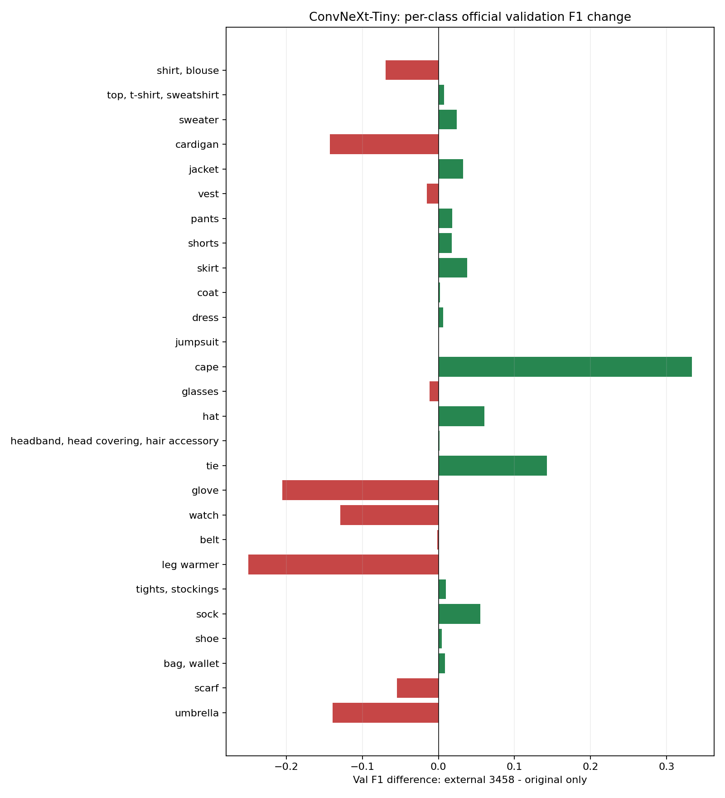

# ConvNeXt 공통 B안: 27개 카테고리별 상세 비교 보고서

## 먼저 읽을 결론

외부 3,458장 실험은 원본-only 대비 공식 val Micro F1과 Image-wise F1은 높아졌지만, 27개 클래스를 동등하게 평균하는 Macro F1은 낮아졌다. 따라서 “전체 카테고리가 좋아졌다”는 뜻은 아니다. 이 보고서는 **동일 공통 증강·부분 라벨 규칙의 원본-only / 외부506 / 외부3458**을 비교한다. 최초 flip-only 베이스라인 및 은진의 고해상도·ASL 실험과 구분한다.

Support는 해당 평가 분할에서 정답이 있는 이미지 수, Precision은 예측한 것 중 맞은 비율, Recall은 실제 정답 중 찾은 비율이다. TP=맞게 찾음, FP=없는데 있다고 예측, FN=있는데 놓침이다. F1은 Precision과 Recall의 조화평균이며 정확도와 다르다. Δ는 3458장 F1에서 비교 실험 F1을 뺀 값이다.

## 27개 클래스 한눈에 보기

|클래스|Holdout 정답 수|Holdout 원본→506→3458 F1|Val 정답 수|Val 원본→506→3458 F1|Val Δ원본|Val Δ506|
|---|---:|---|---:|---|---:|---:|
|shirt, blouse|421|0.7776 → 0.7791 → 0.7770|102|0.7135 → 0.6667 → 0.6441|-0.0694|-0.0226|
|top, t-shirt, sweatshirt|820|0.7685 → 0.7790 → 0.7793|463|0.8030 → 0.7831 → 0.8105|+0.0074|+0.0274|
|sweater|123|0.5427 → 0.5729 → 0.5528|21|0.4762 → 0.5405 → 0.5000|+0.0238|-0.0405|
|cardigan|114|0.5525 → 0.5625 → 0.5816|12|0.3333 → 0.2609 → 0.1905|-0.1429|-0.0704|
|jacket|503|0.7903 → 0.7695 → 0.7788|179|0.7390 → 0.7529 → 0.7714|+0.0324|+0.0186|
|vest|82|0.5238 → 0.4425 → 0.5082|21|0.5000 → 0.5806 → 0.4848|-0.0152|-0.0958|
|pants|730|0.8938 → 0.8794 → 0.8881|313|0.8849 → 0.8997 → 0.9030|+0.0181|+0.0033|
|shorts|216|0.8115 → 0.8184 → 0.8370|106|0.7826 → 0.8070 → 0.8000|+0.0174|-0.0070|
|skirt|332|0.6892 → 0.6824 → 0.7303|162|0.6740 → 0.6810 → 0.7119|+0.0379|+0.0309|
|coat|243|0.7195 → 0.7195 → 0.7273|103|0.7396 → 0.7751 → 0.7419|+0.0024|-0.0332|
|dress|934|0.8677 → 0.8630 → 0.8719|506|0.8845 → 0.8863 → 0.8908|+0.0063|+0.0045|
|jumpsuit|68|0.6195 → 0.5273 → 0.4808|21|0.3226 → 0.3030 → 0.3226|+0.0000|+0.0196|
|cape|16|0.3810 → 0.5385 → 0.4000|5|0.0000 → 0.5714 → 0.3333|+0.3333|-0.2381|
|glasses|405|0.8682 → 0.8675 → 0.8644|130|0.8606 → 0.8560 → 0.8492|-0.0114|-0.0068|
|hat|254|0.8621 → 0.8589 → 0.8806|74|0.7947 → 0.8201 → 0.8552|+0.0605|+0.0350|
|headband, head covering, hair accessory|265|0.6438 → 0.6356 → 0.6557|105|0.6768 → 0.6497 → 0.6784|+0.0016|+0.0286|
|tie|142|0.8636 → 0.7532 → 0.8471|3|0.8571 → 0.8571 → 1.0000|+0.1429|+0.1429|
|glove|83|0.6370 → 0.5867 → 0.6240|18|0.6667 → 0.4571 → 0.4615|-0.2051|+0.0044|
|watch|304|0.5779 → 0.6101 → 0.5823|82|0.6131 → 0.5333 → 0.4844|-0.1288|-0.0490|
|belt|490|0.6545 → 0.6644 → 0.6729|159|0.6296 → 0.6027 → 0.6282|-0.0015|+0.0254|
|leg warmer|8|0.3333 → 0.3636 → 0.5455|7|0.2500 → 0.0000 → 0.0000|-0.2500|+0.0000|
|tights, stockings|225|0.7552 → 0.7287 → 0.7727|62|0.7273 → 0.7255 → 0.7368|+0.0096|+0.0114|
|sock|155|0.5251 → 0.4816 → 0.4156|51|0.4946 → 0.4615 → 0.5500|+0.0554|+0.0885|
|shoe|1439|0.9769 → 0.9768 → 0.9771|804|0.9761 → 0.9775 → 0.9808|+0.0047|+0.0033|
|bag, wallet|500|0.7971 → 0.8038 → 0.8146|205|0.7969 → 0.8124 → 0.8053|+0.0084|-0.0071|
|scarf|150|0.6596 → 0.5643 → 0.6614|48|0.5347 → 0.5000 → 0.4800|-0.0547|-0.0200|
|umbrella|20|0.8571 → 0.8000 → 0.8649|5|0.8889 → 0.8889 → 0.7500|-0.1389|-0.1389|

공식 val에서 원본-only 대비 **상승 16개 / 하락 10개 / 동일 1개**다.

막대는 외부3458 − 원본-only의 F1 차이이며 초록은 상승, 빨강은 하락이다. 단일 seed의 관찰값이고 통계적 유의성이나 인과 효과를 뜻하지 않는다.

## Macro F1 변화에 영향을 준 클래스

Macro F1 변화는 각 클래스 ΔF1을 27로 나눈 기여도의 합이다. 아래의 기여도는 산술 분해이며 데이터가 변화를 일으킨 원인이라는 증거는 아니다.

|클래스|Val 정답 수|ΔF1:3458−원본|Macro 변화 기여(%p)|
|---|---:|---:|---:|
|leg warmer|7|-0.25000|-0.9259|
|glove|18|-0.20513|-0.7597|
|cardigan|12|-0.14286|-0.5291|
|umbrella|5|-0.13889|-0.5144|
|watch|82|-0.12876|-0.4769|
|shirt, blouse|102|-0.06945|-0.2572|
|scarf|48|-0.05465|-0.2024|
|vest|21|-0.01515|-0.0561|
|glasses|130|-0.01135|-0.0420|
|belt|159|-0.00147|-0.0054|
|jumpsuit|21|+0.00000|+0.0000|
|headband, head covering, hair accessory|105|+0.00159|+0.0059|
|coat|103|+0.00235|+0.0087|
|shoe|804|+0.00471|+0.0174|
|dress|506|+0.00629|+0.0233|
|top, t-shirt, sweatshirt|463|+0.00744|+0.0276|
|bag, wallet|205|+0.00839|+0.0311|
|tights, stockings|62|+0.00957|+0.0354|
|shorts|106|+0.01739|+0.0644|
|pants|313|+0.01809|+0.0670|
|sweater|21|+0.02381|+0.0882|
|jacket|179|+0.03243|+0.1201|
|skirt|162|+0.03787|+0.1403|
|sock|51|+0.05538|+0.2051|
|hat|74|+0.06047|+0.2240|
|tie|3|+0.14286|+0.5291|
|cape|5|+0.33333|+1.2346|

## 카테고리별 전체 지표

각 표에는 평가 Support·Precision·Recall·F1·TP·FP·FN을 모두 표시했다. 원본과 외부 데이터의 학습 양성 수와 평가 Support는 다르므로, 평가 Support만 보고 학습 데이터 부족을 단정하지 않는다. 이미지 시각 분석을 새로 수행하지 않았으므로 FP/FN의 시각적 원인을 추측하지 않는다.

### 01. shirt, blouse

|평가|실험|Support|Precision|Recall|F1|TP|FP|FN|
|---|---|---:|---:|---:|---:|---:|---:|---:|
|holdout|원본-only|421|0.8592|0.7102|0.7776|299|49|122|
|holdout|외부506|421|0.8663|0.7078|0.7791|298|46|123|
|holdout|외부3458|421|0.8872|0.6912|0.7770|291|37|130|
|val|원본-only|102|0.7952|0.6471|0.7135|66|17|36|
|val|외부506|102|0.7692|0.5882|0.6667|60|18|42|
|val|외부3458|102|0.7600|0.5588|0.6441|57|18|45|

**관찰:** 3458장 − 원본-only의 F1은 holdout -0.0006, val -0.0694. val FP는 17→18(+1), FN은 36→45(+9)이다.

### 02. top, t-shirt, sweatshirt

|평가|실험|Support|Precision|Recall|F1|TP|FP|FN|
|---|---|---:|---:|---:|---:|---:|---:|---:|
|holdout|원본-only|820|0.7523|0.7854|0.7685|644|212|176|
|holdout|외부506|820|0.7980|0.7610|0.7790|624|158|196|
|holdout|외부3458|820|0.7793|0.7793|0.7793|639|181|181|
|val|원본-only|463|0.8004|0.8056|0.8030|373|93|90|
|val|외부506|463|0.8073|0.7603|0.7831|352|84|111|
|val|외부3458|463|0.8176|0.8035|0.8105|372|83|91|

**관찰:** 3458장 − 원본-only의 F1은 holdout +0.0108, val +0.0074. val FP는 93→83(-10), FN은 90→91(+1)이다.

### 03. sweater

|평가|실험|Support|Precision|Recall|F1|TP|FP|FN|
|---|---|---:|---:|---:|---:|---:|---:|---:|
|holdout|원본-only|123|0.7105|0.4390|0.5427|54|22|69|
|holdout|외부506|123|0.7500|0.4634|0.5729|57|19|66|
|holdout|외부3458|123|0.7237|0.4472|0.5528|55|21|68|
|val|원본-only|21|0.4762|0.4762|0.4762|10|11|11|
|val|외부506|21|0.6250|0.4762|0.5405|10|6|11|
|val|외부3458|21|0.6000|0.4286|0.5000|9|6|12|

**관찰:** 3458장 − 원본-only의 F1은 holdout +0.0101, val +0.0238. val FP는 11→6(-5), FN은 11→12(+1)이다.
**표본 주의:** 공식 val 양성 정답이 30장 미만이라 소수 이미지의 예측 변화가 F1에 크게 반영될 수 있다. 30장은 설명용 구분이며 통계적 판정 기준이 아니다.

### 04. cardigan

|평가|실험|Support|Precision|Recall|F1|TP|FP|FN|
|---|---|---:|---:|---:|---:|---:|---:|---:|
|holdout|원본-only|114|0.7463|0.4386|0.5525|50|17|64|
|holdout|외부506|114|0.6923|0.4737|0.5625|54|24|60|
|holdout|외부3458|114|0.6951|0.5000|0.5816|57|25|57|
|val|원본-only|12|0.5000|0.2500|0.3333|3|3|9|
|val|외부506|12|0.2727|0.2500|0.2609|3|8|9|
|val|외부3458|12|0.2222|0.1667|0.1905|2|7|10|

**관찰:** 3458장 − 원본-only의 F1은 holdout +0.0291, val -0.1429. val FP는 3→7(+4), FN은 9→10(+1)이다.
**표본 주의:** 공식 val 양성 정답이 30장 미만이라 소수 이미지의 예측 변화가 F1에 크게 반영될 수 있다. 30장은 설명용 구분이며 통계적 판정 기준이 아니다.

### 05. jacket

|평가|실험|Support|Precision|Recall|F1|TP|FP|FN|
|---|---|---:|---:|---:|---:|---:|---:|---:|
|holdout|원본-only|503|0.8458|0.7416|0.7903|373|68|130|
|holdout|외부506|503|0.7974|0.7435|0.7695|374|95|129|
|holdout|외부3458|503|0.8152|0.7455|0.7788|375|85|128|
|val|원본-only|179|0.7778|0.7039|0.7390|126|36|53|
|val|외부506|179|0.7751|0.7318|0.7529|131|38|48|
|val|외부3458|179|0.7895|0.7542|0.7714|135|36|44|

**관찰:** 3458장 − 원본-only의 F1은 holdout -0.0114, val +0.0324. val FP는 36→36(+0), FN은 53→44(-9)이다.

### 06. vest

|평가|실험|Support|Precision|Recall|F1|TP|FP|FN|
|---|---|---:|---:|---:|---:|---:|---:|---:|
|holdout|원본-only|82|0.7500|0.4024|0.5238|33|11|49|
|holdout|외부506|82|0.8065|0.3049|0.4425|25|6|57|
|holdout|외부3458|82|0.7750|0.3780|0.5082|31|9|51|
|val|원본-only|21|0.7273|0.3810|0.5000|8|3|13|
|val|외부506|21|0.9000|0.4286|0.5806|9|1|12|
|val|외부3458|21|0.6667|0.3810|0.4848|8|4|13|

**관찰:** 3458장 − 원본-only의 F1은 holdout -0.0156, val -0.0152. val FP는 3→4(+1), FN은 13→13(+0)이다.
**표본 주의:** 공식 val 양성 정답이 30장 미만이라 소수 이미지의 예측 변화가 F1에 크게 반영될 수 있다. 30장은 설명용 구분이며 통계적 판정 기준이 아니다.

### 07. pants

|평가|실험|Support|Precision|Recall|F1|TP|FP|FN|
|---|---|---:|---:|---:|---:|---:|---:|---:|
|holdout|원본-only|730|0.8825|0.9055|0.8938|661|88|69|
|holdout|외부506|730|0.9009|0.8589|0.8794|627|69|103|
|holdout|외부3458|730|0.8792|0.8973|0.8881|655|90|75|
|val|원본-only|313|0.8980|0.8722|0.8849|273|31|40|
|val|외부506|313|0.9115|0.8882|0.8997|278|27|35|
|val|외부3458|313|0.8987|0.9073|0.9030|284|32|29|

**관찰:** 3458장 − 원본-only의 F1은 holdout -0.0057, val +0.0181. val FP는 31→32(+1), FN은 40→29(-11)이다.

### 08. shorts

|평가|실험|Support|Precision|Recall|F1|TP|FP|FN|
|---|---|---:|---:|---:|---:|---:|---:|---:|
|holdout|원본-only|216|0.8374|0.7870|0.8115|170|33|46|
|holdout|외부506|216|0.8128|0.8241|0.8184|178|41|38|
|holdout|외부3458|216|0.8821|0.7963|0.8370|172|23|44|
|val|원본-only|106|0.8020|0.7642|0.7826|81|20|25|
|val|외부506|106|0.7541|0.8679|0.8070|92|30|14|
|val|외부3458|106|0.8283|0.7736|0.8000|82|17|24|

**관찰:** 3458장 − 원본-only의 F1은 holdout +0.0255, val +0.0174. val FP는 20→17(-3), FN은 25→24(-1)이다.

### 09. skirt

|평가|실험|Support|Precision|Recall|F1|TP|FP|FN|
|---|---|---:|---:|---:|---:|---:|---:|---:|
|holdout|원본-only|332|0.8398|0.5843|0.6892|194|37|138|
|holdout|외부506|332|0.8584|0.5663|0.6824|188|31|144|
|holdout|외부3458|332|0.8226|0.6566|0.7303|218|47|114|
|val|원본-only|162|0.8288|0.5679|0.6740|92|19|70|
|val|외부506|162|0.8120|0.5864|0.6810|95|22|67|
|val|외부3458|162|0.7895|0.6481|0.7119|105|28|57|

**관찰:** 3458장 − 원본-only의 F1은 holdout +0.0412, val +0.0379. val FP는 19→28(+9), FN은 70→57(-13)이다.

### 10. coat

|평가|실험|Support|Precision|Recall|F1|TP|FP|FN|
|---|---|---:|---:|---:|---:|---:|---:|---:|
|holdout|원본-only|243|0.7500|0.6914|0.7195|168|56|75|
|holdout|외부506|243|0.6788|0.7654|0.7195|186|88|57|
|holdout|외부3458|243|0.7885|0.6749|0.7273|164|44|79|
|val|원본-only|103|0.7978|0.6893|0.7396|71|18|32|
|val|외부506|103|0.7642|0.7864|0.7751|81|25|22|
|val|외부3458|103|0.8313|0.6699|0.7419|69|14|34|

**관찰:** 3458장 − 원본-only의 F1은 holdout +0.0078, val +0.0024. val FP는 18→14(-4), FN은 32→34(+2)이다.

### 11. dress

|평가|실험|Support|Precision|Recall|F1|TP|FP|FN|
|---|---|---:|---:|---:|---:|---:|---:|---:|
|holdout|원본-only|934|0.8212|0.9197|0.8677|859|187|75|
|holdout|외부506|934|0.8436|0.8833|0.8630|825|153|109|
|holdout|외부3458|934|0.8588|0.8854|0.8719|827|136|107|
|val|원본-only|506|0.8363|0.9387|0.8845|475|93|31|
|val|외부506|506|0.8647|0.9091|0.8863|460|72|46|
|val|외부3458|506|0.8788|0.9032|0.8908|457|63|49|

**관찰:** 3458장 − 원본-only의 F1은 holdout +0.0042, val +0.0063. val FP는 93→63(-30), FN은 31→49(+18)이다.

### 12. jumpsuit

|평가|실험|Support|Precision|Recall|F1|TP|FP|FN|
|---|---|---:|---:|---:|---:|---:|---:|---:|
|holdout|원본-only|68|0.7778|0.5147|0.6195|35|10|33|
|holdout|외부506|68|0.6905|0.4265|0.5273|29|13|39|
|holdout|외부3458|68|0.6944|0.3676|0.4808|25|11|43|
|val|원본-only|21|0.5000|0.2381|0.3226|5|5|16|
|val|외부506|21|0.4167|0.2381|0.3030|5|7|16|
|val|외부3458|21|0.5000|0.2381|0.3226|5|5|16|

**관찰:** 3458장 − 원본-only의 F1은 holdout -0.1387, val +0.0000. val FP는 5→5(+0), FN은 16→16(+0)이다.
**표본 주의:** 공식 val 양성 정답이 30장 미만이라 소수 이미지의 예측 변화가 F1에 크게 반영될 수 있다. 30장은 설명용 구분이며 통계적 판정 기준이 아니다.

### 13. cape

|평가|실험|Support|Precision|Recall|F1|TP|FP|FN|
|---|---|---:|---:|---:|---:|---:|---:|---:|
|holdout|원본-only|16|0.8000|0.2500|0.3810|4|1|12|
|holdout|외부506|16|0.7000|0.4375|0.5385|7|3|9|
|holdout|외부3458|16|1.0000|0.2500|0.4000|4|0|12|
|val|원본-only|5|0.0000|0.0000|0.0000|0|0|5|
|val|외부506|5|1.0000|0.4000|0.5714|2|0|3|
|val|외부3458|5|1.0000|0.2000|0.3333|1|0|4|

**관찰:** 3458장 − 원본-only의 F1은 holdout +0.0190, val +0.3333. val FP는 0→0(+0), FN은 5→4(-1)이다.
**표본 주의:** 공식 val 양성 정답이 30장 미만이라 소수 이미지의 예측 변화가 F1에 크게 반영될 수 있다. 30장은 설명용 구분이며 통계적 판정 기준이 아니다.

### 14. glasses

|평가|실험|Support|Precision|Recall|F1|TP|FP|FN|
|---|---|---:|---:|---:|---:|---:|---:|---:|
|holdout|원본-only|405|0.9106|0.8296|0.8682|336|33|69|
|holdout|외부506|405|0.9151|0.8247|0.8675|334|31|71|
|holdout|외부3458|405|0.9366|0.8025|0.8644|325|22|80|
|val|원본-only|130|0.8926|0.8308|0.8606|108|13|22|
|val|외부506|130|0.8917|0.8231|0.8560|107|13|23|
|val|외부3458|130|0.8770|0.8231|0.8492|107|15|23|

**관찰:** 3458장 − 원본-only의 F1은 holdout -0.0039, val -0.0114. val FP는 13→15(+2), FN은 22→23(+1)이다.

### 15. hat

|평가|실험|Support|Precision|Recall|F1|TP|FP|FN|
|---|---|---:|---:|---:|---:|---:|---:|---:|
|holdout|원본-only|254|0.8506|0.8740|0.8621|222|39|32|
|holdout|외부506|254|0.9079|0.8150|0.8589|207|21|47|
|holdout|외부3458|254|0.8755|0.8858|0.8806|225|32|29|
|val|원본-only|74|0.7792|0.8108|0.7947|60|17|14|
|val|외부506|74|0.8769|0.7703|0.8201|57|8|17|
|val|외부3458|74|0.8732|0.8378|0.8552|62|9|12|

**관찰:** 3458장 − 원본-only의 F1은 holdout +0.0185, val +0.0605. val FP는 17→9(-8), FN은 14→12(-2)이다.

### 16. headband, head covering, hair accessory

|평가|실험|Support|Precision|Recall|F1|TP|FP|FN|
|---|---|---:|---:|---:|---:|---:|---:|---:|
|holdout|원본-only|265|0.8150|0.5321|0.6438|141|32|124|
|holdout|외부506|265|0.7730|0.5396|0.6356|143|42|122|
|holdout|외부3458|265|0.8642|0.5283|0.6557|140|22|125|
|val|원본-only|105|0.7204|0.6381|0.6768|67|26|38|
|val|외부506|105|0.6957|0.6095|0.6497|64|28|41|
|val|외부3458|105|0.8788|0.5524|0.6784|58|8|47|

**관찰:** 3458장 − 원본-only의 F1은 holdout +0.0119, val +0.0016. val FP는 26→8(-18), FN은 38→47(+9)이다.

### 17. tie

|평가|실험|Support|Precision|Recall|F1|TP|FP|FN|
|---|---|---:|---:|---:|---:|---:|---:|---:|
|holdout|원본-only|142|0.9344|0.8028|0.8636|114|8|28|
|holdout|외부506|142|0.9775|0.6127|0.7532|87|2|55|
|holdout|외부3458|142|0.9558|0.7606|0.8471|108|5|34|
|val|원본-only|3|0.7500|1.0000|0.8571|3|1|0|
|val|외부506|3|0.7500|1.0000|0.8571|3|1|0|
|val|외부3458|3|1.0000|1.0000|1.0000|3|0|0|

**관찰:** 3458장 − 원본-only의 F1은 holdout -0.0166, val +0.1429. val FP는 1→0(-1), FN은 0→0(+0)이다.
**표본 주의:** 공식 val 양성 정답이 30장 미만이라 소수 이미지의 예측 변화가 F1에 크게 반영될 수 있다. 30장은 설명용 구분이며 통계적 판정 기준이 아니다.

### 18. glove

|평가|실험|Support|Precision|Recall|F1|TP|FP|FN|
|---|---|---:|---:|---:|---:|---:|---:|---:|
|holdout|원본-only|83|0.8269|0.5181|0.6370|43|9|40|
|holdout|외부506|83|0.6567|0.5301|0.5867|44|23|39|
|holdout|외부3458|83|0.9286|0.4699|0.6240|39|3|44|
|val|원본-only|18|0.8333|0.5556|0.6667|10|2|8|
|val|외부506|18|0.4706|0.4444|0.4571|8|9|10|
|val|외부3458|18|0.7500|0.3333|0.4615|6|2|12|

**관찰:** 3458장 − 원본-only의 F1은 holdout -0.0130, val -0.2051. val FP는 2→2(+0), FN은 8→12(+4)이다.
**표본 주의:** 공식 val 양성 정답이 30장 미만이라 소수 이미지의 예측 변화가 F1에 크게 반영될 수 있다. 30장은 설명용 구분이며 통계적 판정 기준이 아니다.

### 19. watch

|평가|실험|Support|Precision|Recall|F1|TP|FP|FN|
|---|---|---:|---:|---:|---:|---:|---:|---:|
|holdout|원본-only|304|0.6847|0.5000|0.5779|152|70|152|
|holdout|외부506|304|0.5843|0.6382|0.6101|194|138|110|
|holdout|외부3458|304|0.7474|0.4770|0.5823|145|49|159|
|val|원본-only|82|0.7636|0.5122|0.6131|42|13|40|
|val|외부506|82|0.4602|0.6341|0.5333|52|61|30|
|val|외부3458|82|0.6739|0.3780|0.4844|31|15|51|

**관찰:** 3458장 − 원본-only의 F1은 holdout +0.0044, val -0.1288. val FP는 13→15(+2), FN은 40→51(+11)이다.

### 20. belt

|평가|실험|Support|Precision|Recall|F1|TP|FP|FN|
|---|---|---:|---:|---:|---:|---:|---:|---:|
|holdout|원본-only|490|0.8102|0.5490|0.6545|269|63|221|
|holdout|외부506|490|0.7351|0.6061|0.6644|297|107|193|
|holdout|외부3458|490|0.7944|0.5837|0.6729|286|74|204|
|val|원본-only|159|0.7658|0.5346|0.6296|85|26|74|
|val|외부506|159|0.6617|0.5535|0.6027|88|45|71|
|val|외부3458|159|0.7373|0.5472|0.6282|87|31|72|

**관찰:** 3458장 − 원본-only의 F1은 holdout +0.0184, val -0.0015. val FP는 26→31(+5), FN은 74→72(-2)이다.

### 21. leg warmer

|평가|실험|Support|Precision|Recall|F1|TP|FP|FN|
|---|---|---:|---:|---:|---:|---:|---:|---:|
|holdout|원본-only|8|0.5000|0.2500|0.3333|2|2|6|
|holdout|외부506|8|0.6667|0.2500|0.3636|2|1|6|
|holdout|외부3458|8|1.0000|0.3750|0.5455|3|0|5|
|val|원본-only|7|1.0000|0.1429|0.2500|1|0|6|
|val|외부506|7|0.0000|0.0000|0.0000|0|0|7|
|val|외부3458|7|0.0000|0.0000|0.0000|0|0|7|

**관찰:** 3458장 − 원본-only의 F1은 holdout +0.2121, val -0.2500. val FP는 0→0(+0), FN은 6→7(+1)이다.
**표본 주의:** 공식 val 양성 정답이 30장 미만이라 소수 이미지의 예측 변화가 F1에 크게 반영될 수 있다. 30장은 설명용 구분이며 통계적 판정 기준이 아니다.
**해석 한계:** val TP=0이면 threshold0.5에서 맞힌 양성이 없다는 뜻이다. 이것만으로 모델이 시각적 특징을 전혀 학습하지 않았다고 판단할 수 없고, holdout 결과와도 구분해야 한다.

### 22. tights, stockings

|평가|실험|Support|Precision|Recall|F1|TP|FP|FN|
|---|---|---:|---:|---:|---:|---:|---:|---:|
|holdout|원본-only|225|0.9119|0.6444|0.7552|145|14|80|
|holdout|외부506|225|0.9073|0.6089|0.7287|137|14|88|
|holdout|외부3458|225|0.8947|0.6800|0.7727|153|18|72|
|val|원본-only|62|0.8333|0.6452|0.7273|40|8|22|
|val|외부506|62|0.9250|0.5968|0.7255|37|3|25|
|val|외부3458|62|0.8077|0.6774|0.7368|42|10|20|

**관찰:** 3458장 − 원본-only의 F1은 holdout +0.0175, val +0.0096. val FP는 8→10(+2), FN은 22→20(-2)이다.

### 23. sock

|평가|실험|Support|Precision|Recall|F1|TP|FP|FN|
|---|---|---:|---:|---:|---:|---:|---:|---:|
|holdout|원본-only|155|0.6538|0.4387|0.5251|68|36|87|
|holdout|외부506|155|0.6556|0.3806|0.4816|59|31|96|
|holdout|외부3458|155|0.6316|0.3097|0.4156|48|28|107|
|val|원본-only|51|0.5476|0.4510|0.4946|23|19|28|
|val|외부506|51|0.6667|0.3529|0.4615|18|9|33|
|val|외부3458|51|0.7586|0.4314|0.5500|22|7|29|

**관찰:** 3458장 − 원본-only의 F1은 holdout -0.1095, val +0.0554. val FP는 19→7(-12), FN은 28→29(+1)이다.

### 24. shoe

|평가|실험|Support|Precision|Recall|F1|TP|FP|FN|
|---|---|---:|---:|---:|---:|---:|---:|---:|
|holdout|원본-only|1439|0.9852|0.9687|0.9769|1394|21|45|
|holdout|외부506|1439|0.9865|0.9673|0.9768|1392|19|47|
|holdout|외부3458|1439|0.9751|0.9792|0.9771|1409|36|30|
|val|원본-only|804|0.9885|0.9639|0.9761|775|9|29|
|val|외부506|804|0.9812|0.9739|0.9775|783|15|21|
|val|외부3458|804|0.9778|0.9838|0.9808|791|18|13|

**관찰:** 3458장 − 원본-only의 F1은 holdout +0.0002, val +0.0047. val FP는 9→18(+9), FN은 29→13(-16)이다.

### 25. bag, wallet

|평가|실험|Support|Precision|Recall|F1|TP|FP|FN|
|---|---|---:|---:|---:|---:|---:|---:|---:|
|holdout|원본-only|500|0.8355|0.7620|0.7971|381|75|119|
|holdout|외부506|500|0.7741|0.8360|0.8038|418|122|82|
|holdout|외부3458|500|0.8776|0.7600|0.8146|380|53|120|
|val|원본-only|205|0.8547|0.7463|0.7969|153|26|52|
|val|외부506|205|0.7917|0.8341|0.8124|171|45|34|
|val|외부3458|205|0.8743|0.7463|0.8053|153|22|52|

**관찰:** 3458장 − 원본-only의 F1은 holdout +0.0175, val +0.0084. val FP는 26→22(-4), FN은 52→52(+0)이다.

### 26. scarf

|평가|실험|Support|Precision|Recall|F1|TP|FP|FN|
|---|---|---:|---:|---:|---:|---:|---:|---:|
|holdout|원본-only|150|0.6963|0.6267|0.6596|94|41|56|
|holdout|외부506|150|0.7473|0.4533|0.5643|68|23|82|
|holdout|외부3458|150|0.8077|0.5600|0.6614|84|20|66|
|val|원본-only|48|0.5094|0.5625|0.5347|27|26|21|
|val|외부506|48|0.6786|0.3958|0.5000|19|9|29|
|val|외부3458|48|0.6667|0.3750|0.4800|18|9|30|

**관찰:** 3458장 − 원본-only의 F1은 holdout +0.0018, val -0.0547. val FP는 26→9(-17), FN은 21→30(+9)이다.

### 27. umbrella

|평가|실험|Support|Precision|Recall|F1|TP|FP|FN|
|---|---|---:|---:|---:|---:|---:|---:|---:|
|holdout|원본-only|20|1.0000|0.7500|0.8571|15|0|5|
|holdout|외부506|20|0.9333|0.7000|0.8000|14|1|6|
|holdout|외부3458|20|0.9412|0.8000|0.8649|16|1|4|
|val|원본-only|5|1.0000|0.8000|0.8889|4|0|1|
|val|외부506|5|1.0000|0.8000|0.8889|4|0|1|
|val|외부3458|5|1.0000|0.6000|0.7500|3|0|2|

**관찰:** 3458장 − 원본-only의 F1은 holdout +0.0077, val -0.1389. val FP는 0→0(+0), FN은 1→2(+1)이다.
**표본 주의:** 공식 val 양성 정답이 30장 미만이라 소수 이미지의 예측 변화가 F1에 크게 반영될 수 있다. 30장은 설명용 구분이며 통계적 판정 기준이 아니다.

## 비교 조건·한계 및 다음 판단

- 세 실험은 holdout2,425장·val1,158장의 이미지ID·정답·클래스 순서가 동일하다. 저장 NPZ에서 3종F1과 모든 클래스 CSV를 로컬 CPU로 재계산해 일치를 확인했다. 추가 GPU 추론·학습은 하지 않았다.
- 각 실험은 seed42, threshold0.5, 384입력, 공통 약한 증강, 동일한 샘플링 규칙, 유효배치32, 최대30epoch·patience5를 사용했다. 풀 크기에 따른 가중치·실제 노출 분포·best/종료epoch는 달라진다.
- 외부 데이터는 미확인 -1을 제외하는 Masked BCE이며 사람의 27개 클래스 전수 검수 자료가 아니다. 데이터 도메인·부분 라벨·샘플링·단일 seed 변동 중 원인을 이 비교만으로 분리할 수 없다.
- 공식 val은 최종 보고에만 사용했다. 본 보고서를 보고 threshold나 설정을 바꾼 결과를 같은 최종 평가로 보고하지 않는다.
- 개선 후보는 작은 클래스 라벨·도메인 검수, 반복 seed 및 사전 합의한 holdout 실험이다. 현재 추가 실행하지 않았다.

관련 파일: [전체 실험 보고서](V2_3458장_최종실험보고서.md), [원자료 CSV](세실험_27개클래스_상세비교.csv), [전체 F1](세실험_전체F1.csv), [로컬 검증](local_verification.json).
