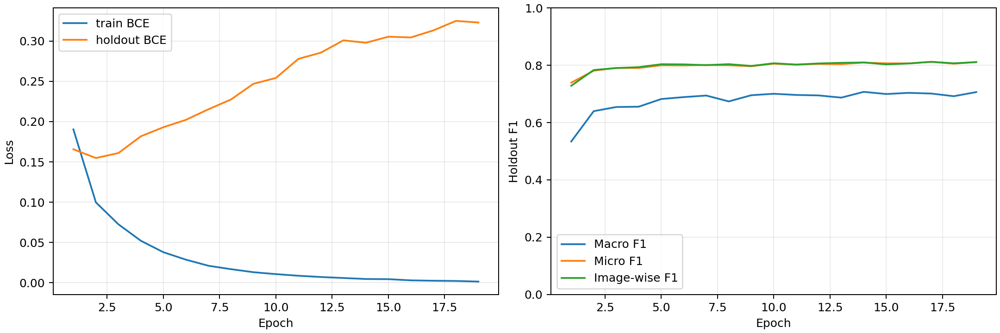

# ConvNeXt-Tiny V2 외부 데이터 3,458장 재학습 결과

## 핵심 결론

**학습·최종 holdout/공식 val 평가·예측 재계산 검증을 완료했다.** V2는 원본-only 대비 holdout의 세 F1이 높아졌지만, 공식 val에서는 Micro/Image-wise F1만 높고 Macro F1은 낮아졌다. 따라서 모든 클래스의 성능 향상이나 외부 데이터 증가의 일관된 효과가 확인됐다고 말할 수 없다. 공식 val을 보고 threshold나 하이퍼파라미터를 조정하지 않았다.

## 세 실험 전체 성능

|분할|실험|Micro F1|Macro F1|Image-wise F1|
|---|---|---:|---:|---:|
|holdout|원본-only|0.804838|0.701820|0.805638|
|holdout|외부506|0.797168|0.689975|0.798758|
|holdout|외부3458|0.809277|0.707107|0.809509|
|val|원본-only|0.818619|0.652603|0.822416|
|val|외부506|0.814441|0.653716|0.813430|
|val|외부3458|0.825295|0.643132|0.826315|

holdout V2 − 원본-only: micro_f1 +0.4439%p, macro_f1 +0.5287%p, image_f1 +0.3871%p.

holdout V2 − 외부506: micro_f1 +1.2109%p, macro_f1 +1.7132%p, image_f1 +1.0751%p.

val V2 − 원본-only: micro_f1 +0.6677%p, macro_f1 -0.9471%p, image_f1 +0.3899%p.

val V2 − 외부506: micro_f1 +1.0854%p, macro_f1 -1.0584%p, image_f1 +1.2885%p.

## 학습 과정과 비용

Best epoch **14**, 종료 epoch **19**. 이후 5개 epoch에서 holdout Macro F1 최고값을 넘지 못해 patience 5로 종료했다. 마지막 모델 대신 best.pt 모델을 최종 평가했다. 최대30epoch 계획의 cosine을 사용했고 종료까지 강제로 압축하지 않았다.

Train Masked BCE는 0.190340 → 0.001510. Holdout BCE 최저는 epoch 2의 0.154812, epoch14는 0.297864, epoch19는 0.322977. 학습 손실 감소와 holdout 손실 상승은 과적합 징후다. BCE는 확률의 자신감까지 평가하지만 F1은 threshold0.5를 넘은 결과만 평가하므로 두 지표가 함께 개선될 필요는 없다. 체크포인트 선택 기준은 사전에 정한 holdout Macro F1이다.

|실험|best/종료|학습 분|val forward ms/장|val 전체 ms/장|최대 할당 GB|GiB|
|---|---|---:|---:|---:|---:|---:|
|원본-only|11/16|57.29|2.701|4.530|3.577|3.331|
|외부506|5/10|77.44|2.724|4.616|3.577|3.331|
|외부3458|14/19|67.65|2.618|4.113|3.577|3.331|

GB=10^9 bytes, GiB=2^30 bytes. 최대값은 PyTorch allocated VRAM이며 nvidia-smi의 전체 프로세스 점유량과 다르다. 학습 시간은 학습 루프 합이며 holdout 선택·최종평가·데이터 준비 시간을 포함하지 않는다. 공유 GPU에서 측정하여 타 실험과 비교 시 하드웨어·부하·I/O를 확인해야 한다. 초기 128장 smoke의 epoch당 약46분 추정은 시작 비용을 크게 반영한 과대 추정이며, 본학습의 실제 측정 시간으로 대체한다. Smoke 성능은 최종 성능에 포함하지 않는다.

파라미터 27,840,891개. 성공 optimizer step 25,641, AMP overflow skip 9회. skip 시 scheduler를 진행하지 않았다. 원본 실제 추출 753,485회 / 외부 67,258회(합 820,743회). 고유 외부 3,458장이 매 epoch 전부 한 번씩 사용되는 방식이 아니라, 공개된 고정 Plan을 복원추출 순서로 재생했다.

## 클래스별 분석

아래는 관심 7개 클래스다. 전체 27개×2분할의 Support·TP·FP·FN·Precision·Recall·F1 및 두 대조군 대비 변화는 `세실험_27개클래스_상세비교.csv`에 있다.

|클래스|분할|Support|원본 F1|506 F1|3458 F1|3458−원본|
|---|---|---:|---:|---:|---:|---:|
|leg warmer|holdout|8|0.3333|0.3636|0.5455|+0.2121|
|leg warmer|val|7|0.2500|0.0000|0.0000|-0.2500|
|cape|holdout|16|0.3810|0.5385|0.4000|+0.0190|
|cape|val|5|0.0000|0.5714|0.3333|+0.3333|
|jumpsuit|holdout|68|0.6195|0.5273|0.4808|-0.1387|
|jumpsuit|val|21|0.3226|0.3030|0.3226|+0.0000|
|vest|holdout|82|0.5238|0.4425|0.5082|-0.0156|
|vest|val|21|0.5000|0.5806|0.4848|-0.0152|
|umbrella|holdout|20|0.8571|0.8000|0.8649|+0.0077|
|umbrella|val|5|0.8889|0.8889|0.7500|-0.1389|
|glove|holdout|83|0.6370|0.5867|0.6240|-0.0130|
|glove|val|18|0.6667|0.4571|0.4615|-0.2051|
|cardigan|holdout|114|0.5525|0.5625|0.5816|+0.0291|
|cardigan|val|12|0.3333|0.2609|0.1905|-0.1429|

원본-only 대비 공식 val 하락 기여가 큰 클래스: leg warmer (-0.2500), glove (-0.2051), cardigan (-0.1429), umbrella (-0.1389), watch (-0.1288).
향상 폭이 큰 클래스: cape (+0.3333), tie (+0.1429), hat (+0.0605), sock (+0.0554), skirt (+0.0379).

Macro F1은 27개 클래스를 같은 가중치로 평균하므로 작은 클래스의 변화도 전체 평균에 영향을 준다. 작은 평가 표본은 추정의 불안정성을 뜻하며 학습 데이터 부족의 증거로 단정할 수 없다. leg warmer의 val F1=0 여부는 표에서 확인하며, 확률 전체가 무의미하거나 시각적으로 인식하지 못했다고 단정하지 않는다. 추가 오류 이미지 시각 분석이나 재추론은 이번 검증에서 하지 않았다.

## 재현 조건·한계

- 모델 convnext_tiny.fb_in22k_ft_in1k_384, 공식 pretrained backbone에서 새 head/optimizer/scheduler/scaler 초기화. 기존 baseline·506장 best 재개 없음.
- GAP → LayerNorm → Linear(768,27), 입력 RGB384, EXIF→공통 Plan Flip/ColorJitter→종횡비 유지 bicubic→중앙 검정 padding→ImageNet mean/std.
- Masked BCE: -1 제외, 누적 구간 확인 라벨 총수로 정규화. AdamW LR backbone1e-4/head1e-3, WD0.05(기존 전체 그룹 적용, bias/norm 예외 추가 없음), batch16×accum2, seed42, threshold0.5.
- Pillow11.3.0. EMA 없음, 추가 Drop Path 없음. 각 epoch43197회, shuffle=False, 추가 sampler·랜덤증강 없음.
- 데이터 V2 외부3458장, 원본inner43197장, 후보46655장, holdout2425·val1158. 30개 Plan/Manifest/Targets/Policy/lock 해시 검증.
- 미확인 라벨을 사람 전수검수 완료로 표시하지 않는다. 부분 라벨·도메인 차이·샘플링 가중치와 노출 분포·학습 종료 시점이 함께 영향을 줄 수 있다. 단일 seed 비교라 반복 실험의 변동은 미확인이다.
- 공식 val은 최종 보고만, 증강·loss·threshold를 val 결과로 조정하지 않았다. 후속 실험은 제안·별도 합의 대상으로 남긴다.
- deterministic 옵션은 warn_only이며 환경·CUDA 연산에 따라 완전한 비트 단위 결정성을 보장하지 않는다.

## 산출물과 검증

서버 원본: `/home/frostpine/fashion_tagging/experiments/role2_jeongeun_convnext/common3458_retrain_20261106`. 가중치 best.pt/last.pt는 이 서버 runs/실험명 아래 보존돼 있다. 후속 공유 준비에서 best.pt를 서버 원본 그대로 로컬로 복사해 SHA-256 일치 및 model 키 CPU strict 로드를 확인했다. 가중치는 GitHub Release에 별도로 첨부하며 원본 이미지·last.pt는 이번 배포에 포함하지 않았다. 추가 재추론 검증은 하지 않았다.

로컬에는 runs/실험명 아래 summary, resolved_config, library_versions, history, 학습곡선, 클래스CSV, 예측NPZ, 실제epoch노출량, 한국어 서버요약과 비교CSV를 보관했다. 로컬 CPU에서 세 실험 NPZ의 평가ID·정답·클래스 순서, 3종F1과 모든 클래스 지표를 재계산하여 CSV·summary와 일치함을 확인했다. GPU 재추론 검증은 아니다.

원본 소스 SHA: c5827dfa749e276d4e5431628a06730b26c4841f. V2 lock SHA-256: e0675cde5e43fbdd2e0e06ca5b4f901a27afedec1ac0dc6e93aed031ed36efc4. 실제 코드 해시는 code_sha256.json, 실행 설정·라이브러리 버전은 runs/실험명 파일 참조. 이후 사용자 승인으로 이 보고서·코드·결과를 별도 GitHub 브랜치에 게시하고 best.pt는 Release에 첨부한다. 기존 원본과 팀원의 파일은 변경하지 않는다.
