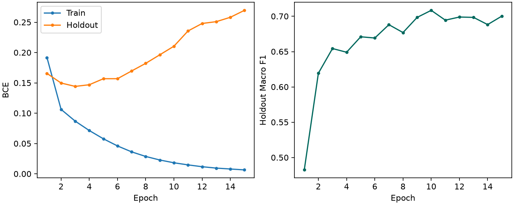

# EVA02-Small 실험 보고서

## 1. 실험 요약

고정 분할로 학습한 EVA02-Small의 공식 Validation Macro F1은 **0.632394**다. Holdout에서 선택한 epoch 10 가중치를 공식 Validation에 한 번 적용했다. 모델의 세부 지표는 아래와 같다.

| 분할 | Micro F1 | Macro F1 | Image-wise F1 |
|---|---:|---:|---:|
| Holdout | 0.804340 | 0.708463 | 0.804744 |
| 공식 Validation | 0.811111 | 0.632394 | 0.815633 |

## 2. 프로젝트와 역할

한 사진에 보이는 모든 사람의 의류·액세서리를 27개 이름의 목록으로 예측한다. 3번 역할은 사전학습 특징 추출기(Backbone)를 EVA02로 바꾸고 분류기(Head), 라벨, 평가 기준을 통제해 팀 CNN 기준선과 비교하는 것이다.

## 3. 구조와 사전학습

Vision Transformer는 이미지를 작은 조각(Patch)으로 나누고 조각 간 관계를 학습한다. EVA02는 ImageNet-22k에서 가린 패치의 특징을 학습한 후 ImageNet-1k로 미세조정됐다. Fine-tuning은 이 가중치에서 시작해 새 과제에 맞게 파라미터를 갱신하는 과정이다. 이 실행은 공식 파일 해시를 확인하고 새 Linear의 두 텐서를 제외한 특징 추출기 전체를 로드했다. [공식 모델 카드](https://huggingface.co/timm/eva02_small_patch14_336.mim_in22k_ft_in1k)

## 4. 데이터와 공통 코드

팀의 고정 명단에 따라 43,197장으로 파라미터를 학습했다. Holdout은 학습하지 않고 모델 선택에만 사용하는 2,425장이다. 공식 Validation은 1,158장이다. categories 순서대로 27개 multi-hot 라벨을 복원하고 CSV·NPZ를 대조했다. 분할 간 동일 이름 및 동일 바이트 이미지가 없었다. 공통 Dataset·전처리·F1 코드는 2번 팀원이 사용한 Git 버전과 일치했다. 자세한 집계는 `data_audit.json`에 있다.

## 5. 입력 해상도와 전처리

378×378의 14픽셀 패치는 27×27개다. 패치 위치를 표현하는 Position Embedding은 기본 24×24에서 bicubic 보간했다. CLS 위치는 유지했다. 회전 위치 특징(RoPE)은 대상 격자에서 생성된다. CLS를 뺀 패치 특징 평균 → LayerNorm → Linear(384→27)를 사용한다. 27개 Logit은 sigmoid를 적용하기 전의 점수다. 원본 JPEG를 EXIF 보정 후 RGB로 변환하고, 비율을 유지해 축소·확대한 뒤 중앙 검정 padding과 체크포인트별 정규화를 한 번 적용했다. 학습에만 수평 반전 0.5를 적용했다.

## 6. 학습 설정

BCEWithLogitsLoss는 각 카테고리의 존재 여부를 logit에서 직접 학습하는 손실이다. AdamW는 gradient에 따라 파라미터를 갱신하며 weight decay를 분리해 적용한다. backbone LR 5e-5, head LR 1e-3, decay 0.05, seed 42다. Gradient accumulation은 16장씩 두 번의 기울기를 모아 유효 배치 32를 만드는 방식이다. AMP는 연산에 혼합 정밀도(FP16)를 사용하는 방법이며 overflow로 갱신을 건너뛰면 scheduler도 멈춘다. 40,500개 계획 갱신 중 첫 2,025개는 warmup, 이후 cosine을 적용했다.

## 7. 학습 과정

실제 15 epoch를 실행했다. Train BCE는 첫 epoch 0.191926에서 마지막 0.006606로 변했다. Epoch별 학습시간, F1, LR, AMP skip, 메모리는 `training_history.csv`에 있다.

## 8. Best 선정

Macro F1은 27개 클래스 F1의 동일 가중 평균이다. 최고 Holdout Macro F1은 epoch 10의 0.708463였다. 같은 점수에서는 더 이른 epoch를 유지했다. Early stopping은 선택 지표의 개선이 멈추면 학습을 끝내는 규칙이다. 종료 epoch 15, 종료 사유는 5 epoch 연속 미개선다.

## 9. Holdout 성능

best를 strict 복원한 뒤 재평가했다. Micro/Macro/Image-wise F1은 0.804340 / 0.708463 / 0.804744다. Holdout BCE는 0.210548다. Micro는 모든 TP/FP/FN을 합산하며 Image-wise는 사진별 F1을 평균한다.

## 10. 공식 Validation

동일한 best와 임계값 0.5에서 공식 Validation BCE는 0.179216였다. 빈 예측 비율은 0.35%, 이미지당 평균 예측 라벨은 3.12개다. 저장한 확률로 세 F1과 클래스별 지표를 재계산해 일치를 확인했다.

## 11. 클래스별 오류

낮은 F1 다섯 클래스는 cardigan 0.162, leg warmer 0.250, sweater 0.389, jumpsuit 0.421, glove 0.438다. leg warmer는 정답 7장에서 TP 1, FP 0, FN 6이었다. 정답 7장에서는 한 장으로도 recall이 1/7 바뀐다.

라벨이 두 개 이상인 1068장 중 314장은 정답 수보다 적은 라벨을 예측했다. 한 사진에서 함께 발생한 FN/FP 중 가장 잦은 조합은 top, t-shirt, sweatshirt 누락과 dress 추가(32장)였다. 이미지 수준 기록만으로 두 물체를 서로 혼동했는지 구분할 수 없다.

## 12. 과적합과 분포

Holdout BCE가 가장 낮은 시점은 epoch 3(0.144301), 마지막은 0.269694였다. 최종 Holdout Macro F1은 0.700228였다. BCE는 확신의 크기에 반응하고 F1은 임계값을 넘는지에 반응한다. 둘은 다른 epoch에서 최적일 수 있다.

공식 Val − Holdout의 Micro/Macro/Image-wise 차이는 +0.006771 / -0.076068 / +0.010890다. 원본 train과 val에서 shoe 등장률은 각각 52.51%, 69.43%였다. 클래스 구성과 표본 수가 달라지는 두 평가셋 사이의 차이를 Private Test 성능으로 환산할 수 없다.

## 13. 파라미터와 비용

전체·학습 가능 파라미터는 모두 21,813,147개, 상한은 50,000,000개다. RTX 4060에서 누적 학습 138.42분, 최대 allocated 3.020 GB, reserved 3.169 GB였다. 공식 Val forward 4.073 ms/장, 로더 포함 19.653 ms/장이다. 시간은 CUDA 동기화를 포함하고 GB는 10⁹ bytes다.

## 14. 한계

Seed 한 개를 측정했다. 공식 Val에서 반복 선택하거나 threshold를 조정하지 않았다. 가림·물체 크기·주석 경계는 별도 검증이 필요한 가설이다. 장비와 체크포인트가 다른 팀 결과의 시간·성능 차이를 아키텍처의 독립 효과로 해석할 수 없다.

## 15. 결론

고정 조건에서 공식 Val의 ConvNeXt 대비 Micro/Macro/Image-wise 차이는 -0.014427 / -0.028360 / -0.012107다. 모델 선택 판단은 [두 백본 비교 보고서](EVA02_vs_ConvNeXt_비교보고서.md)에 기록했다.

## 16. 재현

[실행 안내](README.md)에 의존성, 입력 폴더, train/evaluate/infer 명령을 기록했다. `config.json`은 계획, `resolved_config.json`은 실제 설정이다. 개인별 예측 파일은 비공개 폴더에 저장한다.
