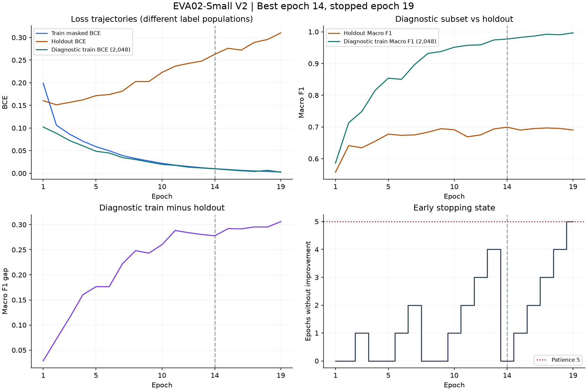

# EVA02-Small V2 재학습 최종 결과 및 분석

검증·정리일: 2026-11-07. **V2 Best Epoch 14의 공식 Validation Macro F1은 0.595302로 원본 Baseline 대비 0.037093 낮았다.** Micro F1은 0.811111에서 0.809412로 0.001699 하락했다. Holdout Macro F1도 0.708463에서 0.699366으로 낮아졌다. 데이터 확대가 성능 개선으로 이어졌다는 근거는 이번 단일 Seed 결과에서 확인되지 않았다.

이 문서는 완료된 실험의 저장 예측·JSON·CSV와 실제 사용 코드를 검증한 기록이다. 이번 결과 정리 과정에서는 학습, EVA 모델 생성, GPU 추론을 실행하지 않았다.

## 1. 실험 목적

원본 Train_inner에 외부 3,458장을 포함한 V2 공통 패키지를 연결하고, 기존 EVA02-Small 기본 학습 조건에서 성능·클래스별 변화·학습 후반 과적합 양상을 확인했다. 비교 대상은 원본 Baseline, 506장 기본 설정, 506장 정규화·EMA 조합이다. Baseline은 flip-only이며 V2는 약한 색 증강·가중 복원추출도 사용하므로, 데이터 장수만 바꾼 통제 실험으로 해석하지 않는다.

## 2. 데이터 구성 및 학습 조건

| 항목 | 실제 설정 |
|---|---|
| 모델 / Backbone | EVA02-Small / `eva02_small_patch14_336.mim_in22k_ft_in1k` |
| 입력 | 378×378, pad, EVA mean/std 유지 |
| 원본 Train_inner / Holdout / 공식 Val | 43,197 / 2,425 / 1,158장 |
| 외부 데이터 / 학습 후보 | 3,458 / 46,655장 |
| 데이터 버전 | `fashion-common-expanded-partial-20261106-v2` |
| Label / Loss | partial / Masked BCE; unknown=-1 제외 |
| Seed / Pillow | 42 / 11.3.0 |
| Epoch Plan / Sampling | V2 30개; 매 Epoch 43,197회 가중 복원추출 |
| Microbatch / 누적 / 유효 Batch / workers | 16 / 2 / 32 / 4 |
| Optimizer | AdamW, 모든 학습 파라미터에 wd 적용 |
| Backbone / Head LR / Weight Decay | 5e-5 / 1e-3 / 0.05 |
| Scheduler | Warmup 5% (2,025 steps) + Cosine; 40,500 planned steps |
| Max Epoch / Early Stopping | 30 / Patience 5 |
| Best 선정 / Threshold | 엄격히 높은 Holdout Macro F1 / sigmoid 확률 ≥ 0.5 |
| 실제 종료 / Best Epoch | 19 / 14 |
| AMP | CUDA FP16 + GradScaler (당시 학습 설정) |
| 추가 정규화 | Dropout 0, Drop Path 0, EMA 없음, ASL 없음; Mixup/CutMix/Label Smoothing 없음 |

원본 `resolved_config.json`과 학습 이력을 우선했다. 요청된 설정표와 실측 설정 사이의 불일치는 없다. `experiment=role3_eva02_common_v1`과 `schema=fashion-common-v1`은 코드의 실험 계열·교환 형식 이름이며 실제 데이터 버전은 V2다. 개인정보·로컬 경로·이미지/라벨 해시 목록을 제외한 값은 [설정 요약](results_v2/experiment_config_summary.json)에 있다. 추가 Dropout/Drop Path는 실제 factory 인자와 당시 timm 1.0.22의 기본값 0을 코드로 확인했으며, 설정 JSON에 없는 정규화 값을 추정해 활성화한 것이 아니다.

Masked BCE는 -1 항목을 Loss와 Gradient에서 제외한다. Gradient accumulation은 두 microbatch의 확인 라벨 수를 합친 분모로 BCE 합을 나눈다. 전부 미확인인 윈도는 갱신하지 않고, AMP가 갱신을 건너뛰면 Scheduler도 진행하지 않는다.

증강은 배포 Plan의 순서와 계수를 재생한다: Flip 0.5, brightness/contrast 0.9–1.1, color 0.95–1.05, hue 0, 클래스 그룹별 jitter 확률 0.35/0.20/0. 기본 샘플링 가중치 1.0, 중간 그룹 1.3, 합친 양성 수 1,000 미만 1.75, leg warmer 2.5이며 이미지 내 양성 클래스의 최댓값을 사용한다. 추가 shuffle·sampler·랜덤 증강을 덧붙이지 않았다.

## 3. Preflight 및 GPU 검증

- 2026-11-06 Preflight 기록: 12/12 PASS, 연결 이미지 50,238개 해시·디코딩 검사, V2 Epoch Plan 30개 및 증강 재생 검증 통과.
- 같은 날 GPU Smoke 기록: 378 입력, 16×2에서 실제 64 draws / 4 forward·backward microbatch / Optimizer 갱신 2회; -1 gradient 0, 유한 gradient·갱신 확인. 최대 할당 2.811 GiB, 예약 2.988 GiB. 이는 당시 짧은 GPU 점검이며 전체 학습 처리량으로 환산하지 않는다.
- 이번 발행 검증: 실제 사용 코드의 최신 main 경로 통합 후 합성 CPU 테스트 **38/38 PASS**. CUDA 초기화·Tensor.cuda·Module.cuda·timm.create_model을 차단했다. 통합 코드의 실제 데이터 Preflight도 **12/12 PASS**이며 원래 data_audit와 같다.
- 저장 Baseline/V2 예측으로 모든 Micro/Macro/Image-wise F1 및 27개 클래스 Precision/Recall/F1/Support/TP/FP/FN 재계산이 기존 파일과 차이 0으로 일치한다. 원본 라벨과 ID·행·클래스 순서도 검증했다.
- SHA 중복 검사는 동일 바이트 기준이다. 시각적 근접 중복이나 라벨 의미의 정확성을 보장하지 않으며, 저장소 README의 기존 근접 중복 주의사항을 해소한 실험이라고 주장하지 않는다.

## 4. 최종 Holdout·Validation 성능

| 분할 | 이미지 | Micro F1 | Macro F1 | Image-wise F1 | BCE | Best Epoch |
|---|---|---|---|---|---|---|
| Holdout | 2425 | 0.7999528885224663 | 0.6993663773630973 | 0.8013460261859291 | 0.2631372213363647 | 14 |
| 공식 Validation | 1158 | 0.8094117647058824 | 0.5953016980415569 | 0.8138479272300962 | 0.2252551913261414 | 14 |

원본 파일: [Holdout JSON](results_v2/metrics_holdout.json), [Validation JSON](results_v2/metrics_val.json). 공식 Validation은 학습·Best 선택·Early Stopping에 사용하지 않고, 학습 종료 후 Holdout으로 선택한 Best Checkpoint의 최종 평가에만 사용했다. 이번 분석은 해당 저장 예측을 재집계했으며 모델을 다시 평가하지 않았다.

## 5. Baseline·506장·V2 비교

| 실험 | Holdout Macro F1 | Val Macro F1 | 출처·조건 |
|---|---|---|---|
| 원본 Baseline | 0.7084628291 | 0.6323943341 | 기존 role3 metrics JSON; Train_inner만, flip-only |
| 외부 506장 기본 설정 | 0.7128 | 0.6248 | role5 보고서 R5_eva_base_s42; 공통 증강·가중 추출 |
| 외부 506장 + 정규화·EMA | 0.7387 | 0.6589 | wd 제외 + Drop Path 0.1 + EMA 0.9995 |
| 외부 3,458장 V2 | 0.6993663774 | 0.5953016980 | 추가 정규화·EMA 없음; Best 14 |

506장 수치는 [role5 results_eva02.md](../role5_regularization/results_eva02.md)의 보고값(소수 4자리)이다. 이 저장소와 이번 로컬 자료에서 해당 실행의 원본 metrics JSON·예측 NPZ는 확보하지 못했으므로 506장 결과를 재계산한 값으로 표시하지 않는다. 원본 Baseline/V2는 원시 저장 예측까지 검증했다. 보고된 Baseline·V2 반올림 수치와 원본 지표 사이의 불일치는 없다.

506장 EMA 조합은 Weight Decay 대상·Drop Path·EMA가 동시에 다르다. 506장과 V2는 외부 구성, 클래스 가중치, 장비·라이브러리도 달라질 수 있다. 따라서 0.6589와 0.5953의 차이를 외부 장수 증가나 EMA 단일 효과로 분리하지 않는다. role5 보고서의 신뢰구간은 그 실험의 비교 결과이며 이번 V2 비교에 전용하지 않는다.

## 6. 27개 클래스별 성능 분석

각 분할의 Support는 정답 양성 이미지 수다. 아래 지표는 반올림 표시이며 CSV에는 원래 정밀도를 유지했다. ΔF1은 V2 − Baseline, 단위는 퍼센트포인트(%p)다. 전체 TP/FP/FN 및 변화는 [Validation 비교 CSV](results_v2/baseline_vs_v2_per_class_val.csv), [Holdout 비교 CSV](results_v2/baseline_vs_v2_per_class_holdout.csv)에 있다.

### 공식 Validation

| 클래스 | Support | Base P | Base R | Base F1 | V2 P | V2 R | V2 F1 | ΔF1 %p |
|---|---|---|---|---|---|---|---|---|
| shirt, blouse | 102 | 0.6456 | 0.5000 | 0.5635 | 0.5983 | 0.6863 | 0.6393 | +7.573 |
| top, t-shirt, sweatshirt | 463 | 0.7904 | 0.7819 | 0.7861 | 0.8075 | 0.7883 | 0.7978 | +1.171 |
| sweater | 21 | 0.4667 | 0.3333 | 0.3889 | 0.4545 | 0.2381 | 0.3125 | -7.639 |
| cardigan | 12 | 0.1200 | 0.2500 | 0.1622 | 0.1250 | 0.1667 | 0.1429 | -1.931 |
| jacket | 179 | 0.8421 | 0.7151 | 0.7734 | 0.7799 | 0.6927 | 0.7337 | -3.969 |
| vest | 21 | 0.6667 | 0.4762 | 0.5556 | 0.6875 | 0.5238 | 0.5946 | +3.904 |
| pants | 313 | 0.8667 | 0.9137 | 0.8896 | 0.8685 | 0.9073 | 0.8875 | -0.208 |
| shorts | 106 | 0.7581 | 0.8868 | 0.8174 | 0.7830 | 0.7830 | 0.7830 | -3.437 |
| skirt | 162 | 0.7664 | 0.6481 | 0.7023 | 0.7600 | 0.5864 | 0.6620 | -4.032 |
| coat | 103 | 0.7753 | 0.6699 | 0.7188 | 0.7717 | 0.6893 | 0.7282 | +0.946 |
| dress | 506 | 0.8848 | 0.9111 | 0.8978 | 0.8779 | 0.9091 | 0.8932 | -0.456 |
| jumpsuit | 21 | 0.4706 | 0.3810 | 0.4211 | 0.3704 | 0.4762 | 0.4167 | -0.439 |
| cape | 5 | 0.5000 | 0.4000 | 0.4444 | 0.5000 | 0.2000 | 0.2857 | -15.873 |
| glasses | 130 | 0.9245 | 0.7538 | 0.8305 | 0.9300 | 0.7154 | 0.8087 | -2.181 |
| hat | 74 | 0.8784 | 0.8784 | 0.8784 | 0.9355 | 0.7838 | 0.8529 | -2.544 |
| headband, head covering, hair accessory | 105 | 0.6250 | 0.6190 | 0.6220 | 0.7937 | 0.4762 | 0.5952 | -2.677 |
| tie | 3 | 1.0000 | 0.3333 | 0.5000 | 0.3333 | 0.3333 | 0.3333 | -16.667 |
| glove | 18 | 0.5000 | 0.3889 | 0.4375 | 0.6364 | 0.3889 | 0.4828 | +4.526 |
| watch | 82 | 0.4947 | 0.5732 | 0.5311 | 0.6591 | 0.3537 | 0.4603 | -7.076 |
| belt | 159 | 0.7328 | 0.5346 | 0.6182 | 0.8085 | 0.4780 | 0.6008 | -1.739 |
| leg warmer | 7 | 1.0000 | 0.1429 | 0.2500 | 0.0000 | 0.0000 | 0.0000 | -25.000 |
| tights, stockings | 62 | 0.6866 | 0.7419 | 0.7132 | 0.8511 | 0.6452 | 0.7339 | +2.077 |
| sock | 51 | 0.6538 | 0.3333 | 0.4416 | 0.5676 | 0.4118 | 0.4773 | +3.571 |
| shoe | 804 | 0.9777 | 0.9826 | 0.9801 | 0.9731 | 0.9888 | 0.9809 | +0.073 |
| bag, wallet | 205 | 0.8743 | 0.7805 | 0.8247 | 0.8579 | 0.7659 | 0.8093 | -1.546 |
| scarf | 48 | 0.4375 | 0.4375 | 0.4375 | 0.7222 | 0.2708 | 0.3939 | -4.356 |
| umbrella | 5 | 1.0000 | 0.8000 | 0.8889 | 0.7500 | 0.6000 | 0.6667 | -22.222 |

개선 8개, 하락 19개. 큰 하락: leg warmer -25.000%p, umbrella -22.222%p, tie -16.667%p. 큰 개선: shirt, blouse +7.573%p, glove +4.526%p, vest +3.904%p.

### Holdout

| 클래스 | Support | Base P | Base R | Base F1 | V2 P | V2 R | V2 F1 | ΔF1 %p |
|---|---|---|---|---|---|---|---|---|
| shirt, blouse | 421 | 0.8475 | 0.7126 | 0.7742 | 0.7904 | 0.7791 | 0.7847 | +1.050 |
| top, t-shirt, sweatshirt | 820 | 0.7701 | 0.7720 | 0.7710 | 0.7704 | 0.7732 | 0.7718 | +0.075 |
| sweater | 123 | 0.6463 | 0.4309 | 0.5171 | 0.7581 | 0.3821 | 0.5081 | -0.897 |
| cardigan | 114 | 0.6250 | 0.6140 | 0.6195 | 0.7470 | 0.5439 | 0.6294 | +0.997 |
| jacket | 503 | 0.8451 | 0.7157 | 0.7750 | 0.8158 | 0.7396 | 0.7758 | +0.078 |
| vest | 82 | 0.6282 | 0.5976 | 0.6125 | 0.7755 | 0.4634 | 0.5802 | -3.235 |
| pants | 730 | 0.8770 | 0.9178 | 0.8969 | 0.8675 | 0.9151 | 0.8907 | -0.625 |
| shorts | 216 | 0.7679 | 0.8426 | 0.8035 | 0.8579 | 0.7824 | 0.8184 | +1.487 |
| skirt | 332 | 0.7978 | 0.6416 | 0.7112 | 0.8517 | 0.6054 | 0.7077 | -0.344 |
| coat | 243 | 0.7393 | 0.7819 | 0.7600 | 0.7696 | 0.6872 | 0.7261 | -3.391 |
| dress | 934 | 0.8645 | 0.9015 | 0.8826 | 0.8621 | 0.8972 | 0.8793 | -0.327 |
| jumpsuit | 68 | 0.6944 | 0.3676 | 0.4808 | 0.6667 | 0.5294 | 0.5902 | +10.939 |
| cape | 16 | 0.7143 | 0.3125 | 0.4348 | 1.0000 | 0.1875 | 0.3158 | -11.899 |
| glasses | 405 | 0.9323 | 0.7481 | 0.8301 | 0.9414 | 0.7136 | 0.8118 | -1.834 |
| hat | 254 | 0.8711 | 0.8780 | 0.8745 | 0.9045 | 0.7835 | 0.8397 | -3.485 |
| headband, head covering, hair accessory | 265 | 0.6838 | 0.6038 | 0.6413 | 0.7514 | 0.5019 | 0.6018 | -3.947 |
| tie | 142 | 0.9725 | 0.7465 | 0.8446 | 0.9545 | 0.7394 | 0.8333 | -1.129 |
| glove | 83 | 0.7812 | 0.6024 | 0.6803 | 0.8000 | 0.5783 | 0.6713 | -0.894 |
| watch | 304 | 0.5886 | 0.5789 | 0.5837 | 0.6949 | 0.4046 | 0.5114 | -7.231 |
| belt | 490 | 0.8086 | 0.5000 | 0.6179 | 0.8215 | 0.4980 | 0.6201 | +0.217 |
| leg warmer | 8 | 0.7500 | 0.3750 | 0.5000 | 0.8000 | 0.5000 | 0.6154 | +11.538 |
| tights, stockings | 225 | 0.8170 | 0.8133 | 0.8151 | 0.8987 | 0.6311 | 0.7415 | -7.363 |
| sock | 155 | 0.8367 | 0.2645 | 0.4020 | 0.5918 | 0.3742 | 0.4585 | +5.654 |
| shoe | 1439 | 0.9805 | 0.9785 | 0.9795 | 0.9712 | 0.9847 | 0.9779 | -0.156 |
| bag, wallet | 500 | 0.8818 | 0.7460 | 0.8082 | 0.8759 | 0.7480 | 0.8069 | -0.133 |
| scarf | 150 | 0.7120 | 0.5933 | 0.6473 | 0.8778 | 0.5267 | 0.6583 | +1.106 |
| umbrella | 20 | 0.9412 | 0.8000 | 0.8649 | 0.8235 | 0.7000 | 0.7568 | -10.811 |

개선 10개, 하락 17개. 큰 하락: cape -11.899%p, umbrella -10.811%p, tights, stockings -7.363%p. 큰 개선: leg warmer +11.538%p, jumpsuit +10.939%p, sock +5.654%p.

### 중점 클래스와 분할 차이

| 클래스 | Val support | Val F1 | Val Δ %p | Hold support | Hold F1 | Hold Δ %p | V2 Val−Hold |
|---|---|---|---|---|---|---|---|
| watch | 82 | 0.4603 | -7.076 | 304 | 0.5114 | -7.231 | -0.0511 |
| umbrella | 5 | 0.6667 | -22.222 | 20 | 0.7568 | -10.811 | -0.0901 |
| leg warmer | 7 | 0.0000 | -25.000 | 8 | 0.6154 | +11.538 | -0.6154 |
| cape | 5 | 0.2857 | -15.873 | 16 | 0.3158 | -11.899 | -0.0301 |
| tie | 3 | 0.3333 | -16.667 | 142 | 0.8333 | -1.129 | -0.5000 |
| sock | 51 | 0.4773 | +3.571 | 155 | 0.4585 | +5.654 | +0.0188 |
| glove | 18 | 0.4828 | +4.526 | 83 | 0.6713 | -0.894 | -0.1886 |

| 분할·클래스 | TP Base→V2 | FP Base→V2 | FN Base→V2 |
|---|---|---|---|
| Val / watch | 47 → 29 | 48 → 15 | 35 → 53 |
| Val / umbrella | 4 → 3 | 0 → 1 | 1 → 2 |
| Val / leg warmer | 1 → 0 | 0 → 1 | 6 → 7 |
| Val / cape | 2 → 1 | 2 → 1 | 3 → 4 |
| Val / tie | 1 → 1 | 0 → 2 | 2 → 2 |
| Val / sock | 17 → 21 | 9 → 16 | 34 → 30 |
| Val / glove | 7 → 7 | 7 → 4 | 11 → 11 |
| Holdout / watch | 176 → 123 | 123 → 54 | 128 → 181 |
| Holdout / umbrella | 16 → 14 | 1 → 3 | 4 → 6 |
| Holdout / leg warmer | 3 → 4 | 1 → 1 | 5 → 4 |
| Holdout / cape | 5 → 3 | 2 → 0 | 11 → 13 |
| Holdout / tie | 106 → 105 | 3 → 5 | 36 → 37 |
| Holdout / sock | 41 → 58 | 8 → 40 | 114 → 97 |
| Holdout / glove | 50 → 48 | 14 → 12 | 33 → 35 |

- **Watch:** 양쪽 분할에서 Precision은 오르고 Recall/F1은 하락했다. Val TP 47→29, FP 48→15, FN 35→53; Holdout TP 176→123, FP 123→54, FN 128→181이다. 예측을 덜 하면서 오탐과 정탐이 함께 감소한 양상이다.
- **Umbrella:** 외부 양성 1,700장이 있어도 Val/Holdout F1이 각각 22.222/10.811%p 낮아졌다. 더 많은 양성 노출이 이 평가셋에서의 일반화 향상을 보장하지 않았다.
- **Leg warmer:** Holdout은 TP 3→4로 개선됐지만 Val은 TP 1→0, F1 0.25→0이다. 분할별 support 8/7만으로 일반화 방향을 확정할 수 없다.
- **Cape:** Val support 5에서 TP 2→1, Holdout support 16에서 TP 5→3이다. Holdout Precision 1.0도 FP 0에서 나온 값이며 Recall 개선을 뜻하지 않는다.
- **Tie:** Val support 3에서 TP=1·FN=2는 그대로이고 FP 0→2로 F1이 하락했다. 모든 하락을 Recall 손실로 설명하면 안 된다.
- **Sock:** 양쪽에서 Recall과 F1이 개선됐지만 FP도 증가하고 Precision은 하락했다. 전체적인 보수적 예측 경향과 반대인 클래스다.
- **Glove:** Val은 TP=7·FN=11을 유지하며 FP 7→4로 개선; Holdout은 TP 50→48로 소폭 하락했다. 대량 외부 보강의 이득이 두 분할에서 일관되지는 않았다.

### 작은 Support와 Macro F1

Val support가 각각 7/5/3/5인 leg warmer·umbrella·tie·cape의 합산 Macro 변화 기여는 -0.029541로, 전체 순변화 -0.037093의 약 79.6%에 해당한다. 이는 각 ΔF1/27을 더한 산술적 기여이며 원인 분해나 통계적 유의성 주장이 아니다. Macro는 support와 무관하게 클래스마다 1/27 가중치를 주므로 소수 이미지의 TP/FP 변화도 크게 반영된다.

표본이 작은 클래스는 불확실성이 크다. 이번에는 신규 부트스트랩 신뢰구간이나 다중 Seed 검정을 수행하지 않았으므로 유의한 개선·악화로 단정하지 않는다. Holdout은 Best 선택에도 쓰였고 분할의 클래스 구성도 다르므로 Val−Holdout 차이를 순수한 일반화 오차로 해석하지 않는다.

### 실제 노출과 외부 데이터의 관계

`actual_class_exposure.csv`는 원본+외부를 합친 노출을 기록한다. 외부만의 노출은 실행된 Epoch Plan의 index를 로컬 Manifest source·Targets와 결합해 재집계했다. 19×27=513개 클래스/Epoch의 전체 positive/known/unknown/draws 및 이력의 known_labels가 실제 로그와 모두 일치한 뒤 외부 부분을 분리했다. 아래 값은 이미지 ID나 라벨 행을 공개하지 않는 집계다.

| 클래스 | 외부 고유 양성 | 전체 양성 노출 ≤14 | 외부 양성 노출 ≤14 | 외부 양성 노출 ≤19 |
|---|---|---|---|---|
| watch | 87 | 48829 | 1441 | 1915 |
| umbrella | 1700 | 21998 | 20500 | 27748 |
| leg warmer | 54 | 3071 | 1536 | 2069 |
| cape | 16 | 3076 | 311 | 427 |
| tie | 145 | 20161 | 2786 | 3782 |
| sock | 35 | 20487 | 546 | 768 |
| glove | 1376 | 31239 | 20805 | 28294 |

Best Epoch 14까지 총 604,758 draws 중 외부 49,628회(8.206%), 종료 Epoch 19까지 총 820,743 draws 중 외부 67,258회(8.195%)였다. 외부 3,458개 고유 이미지는 Epoch 14까지 모두 한 번 이상 노출됐다. 최종 Best 성능 해석에는 ≤14 노출을 우선하며 15–19 노출이 Best 가중치에 들어갔다고 해석하지 않는다.

외부 Targets의 91.527%가 -1이다. 외부가 제공한 확인 라벨 수 비중은 ≤14에서 0.754%, ≤19에서 0.752%였다. 이 값은 확인 라벨 항목 수의 비중으로 gradient 크기나 학습 효과의 비중은 아니다. AMP skip 윈도도 이미 모델이 소비한 draw이므로 노출 수에 포함된다.

Watch·Tie·Sock은 외부 보강의 대표 선별 대상이 아니어도 다중 라벨로 각각 87/145/35개 외부 양성이 있다. 이를 외부 양성 0으로 처리하지 않았다. Umbrella의 ≤14 외부 양성 20,500회와 Glove의 20,805회도 각각 성능 저하·분할별 혼합 결과와 공존한다. 노출량과 F1 변화의 관측만으로 원인·인과관계를 확정하지 않는다. 전체 27개 집계는 [analysis_summary.json](results_v2/analysis_summary.json)의 exposure에 있다.

## 7. Precision·Recall 및 예측 성향 변화

| 분할 | 실험 | Micro P | Micro R | Macro P | Macro R | 예측 라벨/장 | TP | FP | FN |
|---|---|---|---|---|---|---|---|---|---|
| Val | Baseline | 0.828397 | 0.794531 | 0.716245 | 0.598779 | 3.120035 | 2993 | 620 | 774 |
| Val | V2 | 0.845575 | 0.776214 | 0.674167 | 0.550332 | 2.986183 | 2924 | 534 | 843 |
| Holdout | Baseline | 0.841140 | 0.770626 | 0.791651 | 0.660615 | 3.416082 | 6968 | 1316 | 2074 |
| Holdout | V2 | 0.855523 | 0.751161 | 0.823698 | 0.628497 | 3.273814 | 6792 | 1147 | 2250 |

**Micro Precision 상승·Micro Recall 하락은 두 분할에서 확인된다.** 다만 Val Macro Precision은 0.716245→0.674167로 하락하고 Holdout Macro Precision은 0.791651→0.823698로 상승한다. 따라서 “전체 Precision이 상승했다”는 문장은 집계 방식을 명시해야 한다. 클래스별 Precision 상승·Recall 하락은 Val 10개, Holdout 15개다.

Val은 TP −69, FP −86, FN +69, Holdout은 TP −176, FP −169, FN +176이다. 이미지당 예측 라벨 수가 두 분할에서 줄었고 Micro F1은 소폭 낮아졌다. 이것은 threshold 0.5에서의 관측이며 확률 보정 실패나 과도한 보수성의 원인을 확정하는 증거는 아니다.

## 8. 과적합과 Early Stopping 분석



**진단 Train Macro F1은 전체 Train이 아니라 Seed 42로 고정한 Train_inner 2,048장 부분집합의 무증강 평가값**이다. 전체 Train 성능으로 표현하지 않는다. 부분집합의 희귀 클래스 support도 작으며 진단은 Best 선택에 사용되지 않는다.

| Epoch | Train Masked BCE | Holdout BCE | Holdout Macro | 진단 Train Macro | Train−Holdout 격차 | Best | 미개선 |
|---|---|---|---|---|---|---|---|
| 1 | 0.198840 | 0.160427 | 0.557433 | 0.585997 | 0.028564 | 1 | 0 |
| 2 | 0.106124 | 0.151293 | 0.641170 | 0.713193 | 0.072023 | 2 | 0 |
| 3 | 0.086446 | 0.156634 | 0.634343 | 0.748975 | 0.114633 | 2 | 1 |
| 4 | 0.070974 | 0.162116 | 0.654840 | 0.815115 | 0.160276 | 4 | 0 |
| 5 | 0.058800 | 0.171527 | 0.677351 | 0.853862 | 0.176511 | 5 | 0 |
| 6 | 0.049799 | 0.173979 | 0.673687 | 0.850117 | 0.176430 | 5 | 1 |
| 7 | 0.039232 | 0.181463 | 0.675004 | 0.896950 | 0.221946 | 5 | 2 |
| 8 | 0.032544 | 0.202729 | 0.683479 | 0.931738 | 0.248259 | 8 | 0 |
| 9 | 0.027184 | 0.202622 | 0.694647 | 0.937913 | 0.243266 | 9 | 0 |
| 10 | 0.021909 | 0.222836 | 0.691212 | 0.951292 | 0.260080 | 9 | 1 |
| 11 | 0.018039 | 0.236589 | 0.669042 | 0.957523 | 0.288481 | 9 | 2 |
| 12 | 0.015021 | 0.242720 | 0.675014 | 0.958983 | 0.283970 | 9 | 3 |
| 13 | 0.012314 | 0.247774 | 0.693760 | 0.974258 | 0.280498 | 9 | 4 |
| 14 | 0.009990 | 0.263137 | 0.699366 | 0.977152 | 0.277786 | 14 | 0 |
| 15 | 0.008288 | 0.276082 | 0.690187 | 0.982243 | 0.292056 | 14 | 1 |
| 16 | 0.006462 | 0.272146 | 0.694825 | 0.986392 | 0.291567 | 14 | 2 |
| 17 | 0.005095 | 0.289280 | 0.696858 | 0.992311 | 0.295453 | 14 | 3 |
| 18 | 0.003985 | 0.295631 | 0.695331 | 0.990641 | 0.295310 | 14 | 4 |
| 19 | 0.002762 | 0.310256 | 0.690578 | 0.996718 | 0.306140 | 14 | 5 |

관측: Train Masked BCE는 0.198840→0.002762로 감소했다. Holdout BCE는 Epoch 2의 0.151293가 최저이고 종료 시 0.310256까지 상승했다. 진단 Train Macro는 0.585997→0.996718, 격차는 0.028564→0.306140로 커졌다.

Best는 Epoch 14의 0.699366이고 Epoch 15–19에 이를 넘지 못해 19에서 Patience 5로 종료했다. 마지막 Holdout Macro는 0.690578이며 Best보다 0.008788 낮다. 최종 JSON은 마지막 가중치가 아니라 Best 14 평가다. 후반 점수가 매 Epoch 단조 하락한 것은 아니며 17에서 일시 반등했다.

해석: 학습/진단 성능 향상과 Holdout BCE 악화·격차 확대가 함께 나타나므로 과적합 및 확률 과신 가능성과 일치하는 양상이다. 그러나 Train Masked BCE와 완전 라벨 Holdout BCE의 구성·정규화는 다르므로 두 Loss의 절대 차이만으로 원인을 확정하지 않는다. 경고는 진단용이며 Early Stopping은 Holdout Macro만으로 제어됐다.

Epoch 15 완료 후 중단한 뒤 Model·Optimizer·Scheduler·GradScaler·RNG·이력을 복원해 16부터 이어서 19까지 학습했다. 원본 Baseline과 중단 시점 V2 체크포인트는 로컬에 보존했고 재개 결과는 별도 작업 폴더에 기록했다.

## 9. 성능 저하에 대한 가능한 원인

| 구분 | 관측 근거 | 확정하지 않은 설명 |
|---|---|---|
| 희귀 클래스 표본 변동 | Val support 3–7의 여러 클래스에서 큰 ΔF1 | 표본 오차가 하락의 전부라는 주장은 미검증 |
| 원본·외부 도메인/라벨 차이 | 외부 양성 반복 노출에도 Umbrella/Watch 저하 | 라벨 오류·배경·가림·작은 물체·도메인 차이가 원인이라는 것은 가설 |
| 부분 라벨의 기여 제한 | 외부 draw 약 8.2%, known 항목 수 약 0.75% | -1을 0으로 바꾸면 좋아진다는 결론은 잘못된 추론이며 제안하지 않음 |
| 샘플링 분포 변화 | 고정 43,197회 복원추출, 데이터 구성으로 가중치 재산정 | 데이터 장수 자체와 sampling의 영향을 이번 결과에서 분리 불가 |
| 후반 과적합/확률 보정 | Holdout BCE 상승·진단 격차 확대·Recall 하락 | 정규화 또는 threshold 변경의 효과는 새 실험 필요 |

단일 Seed이며 다른 실험과 장비·라이브러리도 완전히 같지 않다. 독립적인 데이터 증가 효과나 특정 정규화 기법의 우월성을 확정하지 않는다.

## 10. 다음 실험 제안 — 모두 향후 검증할 가설

1. **해상도 378→448:** 작은 액세서리의 Recall 개선 가능성을 검증한다. 448은 patch14의 배수지만 현재 V2 preflight의 378 고정 조건을 유지한 채 CLI 값만 바꾸는 실험은 지원하지 않는다. 별도 실험 설정/경로에서 positional embedding과 RoPE·메모리·유효 Batch를 검증하고 378 대조군과 비교한다.
2. **확률·Threshold 진단:** 클래스별 양성/음성 확률 분포와 PR 곡선을 저장 예측으로 분석한다. 임계값 선택은 Holdout 내부의 별도 calibration 분할 또는 교차 검증으로 수행하고 공식 Val에 맞춰 고르지 않는다. 현재 보고값의 threshold 0.5는 변경하지 않는다.
3. **부분 라벨·샘플링 분리:** 동일 Seed/step/증강에서 원본-only, 506, 3,458을 비교하고, 외부 선택 확률을 독립 요인으로 분리한다. unknown은 계속 -1로 유지하며 사람의 표적 라벨 검수·확인 라벨당 기여를 함께 점검한다.
4. **희귀 클래스 Recall 개선:** Watch·Leg warmer·Cape의 FN을 승인된 환경에서 점검하고 목표 domain의 양성·확인 음성을 보완한다. 여러 Seed와 이미지 단위 paired bootstrap을 추가해 support가 작은 클래스의 불확실성을 보고한다.
5. **정규화와 데이터 확대 분리:** 같은 데이터에서 기본, EMA 단독, Drop Path 단독, wd 대상 변경을 분리한다. 이후 데이터 크기와의 상호작용을 비교한다. 506장 조합 결과만으로 V2+EMA 개선을 기정사실로 두지 않는다.

## 11. 재현 방법 및 결과 파일 위치

[결과 파일 설명](results_v2/README.md), [설정 요약](results_v2/experiment_config_summary.json), [코드 출처](results_v2/code_provenance.json), [검증 요약](results_v2/validation_summary.json)을 함께 확인한다. 체크포인트·이미지·예측 NPZ·원본 라벨·Manifest·이미지 해시 목록은 이 브랜치에 추가하지 않았다. 결과는 사용자 요청에 따라 현재 Private인 팀 저장소에 코드와 집계 정보만 공유한다. 과제 원본은 LMS 배포 자료이며 재배포 허가가 있다고 가정하지 않는다.

### 코드 출처와 main 통합

- 실제 V2 학습: `feature/eva02-common-data-retrain`의 `a84528284cc8f8d2ae6177caeee67fee05b92af4` + 로컬 모니터링 변경 6개 파일. 실행 복사본의 9개 Python 모듈은 원본 작업 폴더 및 Preflight 이후 Smoke 보존 해시와 동일하다.
- `role3-eva02`는 Baseline 브랜치이고, `feature/eva02-retrain-main-layout`의 `d4a4b988b9957eca20d9f33b2012b5a4d3612df0` 및 최신 main에는 경로 통합판이 있다. 최종 모니터링 코드 전체가 일치하는 기존 원격 브랜치는 없었다.
- 이번 브랜치는 최신 main `0670ee1d82fd23c8c61f312dfada7983d782ab47`에서 시작했다. main의 `src/fashion_tagging`, `data/splits`, `scripts/train.py` 경로를 보존하고 실제 학습 변경만 추가했다. `batches.py`, `trainer.py`, `test_retrain.py`는 import 경로만 조정했고 구현 AST는 실행본과 일치한다. 모니터링 모듈/테스트의 구현도 동일하다.
- 최신 공통 Optimizer에는 `is_head` 메타데이터, Scheduler에는 LP-FT 확장이 있지만 이번 EVA 호출의 LP-FT는 0이다. 두 AdamW 그룹의 파라미터·수치 설정, 0–40,500의 40,501개 스케줄 값이 기존과 일치함을 CPU에서 확인했다. seed/predict/전처리/지표 핵심 함수도 AST 일치한다. 공통 코드·ConvNeXt·role5 파일을 수정하지 않았다.
- 통합본은 파일 단위로 당시 환경 전체와 동일한 아카이브가 아니다. 사용한 학습 알고리즘과 기본 호출 동작의 동일성을 검증한 경로 통합판이다. 동일 GPU 학습 궤적이나 비트 단위 성능 재현은 이번 발행에서 재실행하지 않았다.

### 실행 예시 (문서용이며 이번에는 실행하지 않음)

승인된 로컬 데이터 경로를 환경변수로 지정하고 V2와 같은 의존성 버전을 사용한다. 첫 명령은 모델 학습 없이 Preflight만 수행한다.

```powershell
$opts = @(
  "--package", $env:EVA_PACKAGE,
  "--shared-lock", $env:EVA_SHARED_LOCK,
  "--train-root", $env:EVA_TRAIN_ROOT,
  "--val-root", $env:EVA_VAL_ROOT,
  "--external-root", $env:EVA_EXTERNAL_ROOT,
  "--weights", $env:EVA_WEIGHTS,
  "--run-id", "eva02-v2-reproduction-s42",
  "--label-mode", "partial"
)
python -B -m experiments.role3_eva02.retrain_common_data.cli preflight @opts
# 별도 재현 실험을 실제 시작할 때만 사용
python -B -m experiments.role3_eva02.retrain_common_data.cli train @opts
# 동일 run의 중단된 last.pt를 이어갈 때만 사용
python -B -m experiments.role3_eva02.retrain_common_data.cli train @opts --resume
```

새 학습은 기존 run 폴더가 있으면 실패한다. Resume은 같은 run_id·동일 설정·동일 데이터 lock과 best/last/diagnostic_subset이 필요하며 해당 run의 last/이력을 갱신한다. 원본 보존이 필요하면 실제 작업처럼 별도 복사본에서 이어간다. 현재 완료된 run을 다시 학습시키는 명령으로 사용하지 않는다.

합성 CPU 검사: `python -B -m unittest experiments.role3_eva02.retrain_common_data.test_retrain experiments.role3_eva02.retrain_common_data.test_monitoring -v`. 이번 검수에서는 추가로 실제 EVA 생성과 CUDA 호출을 차단했다.
