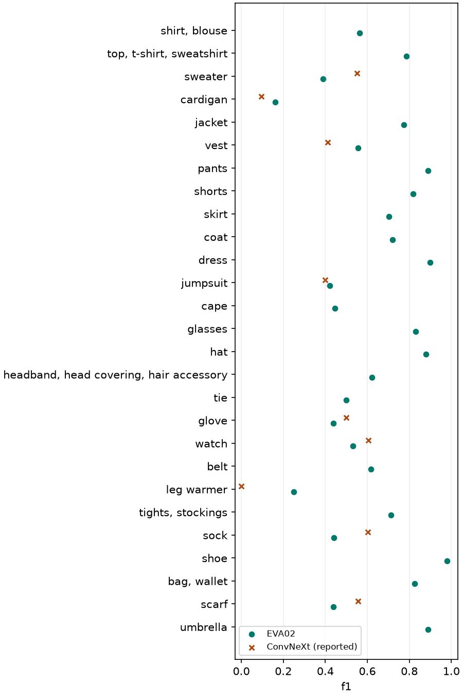
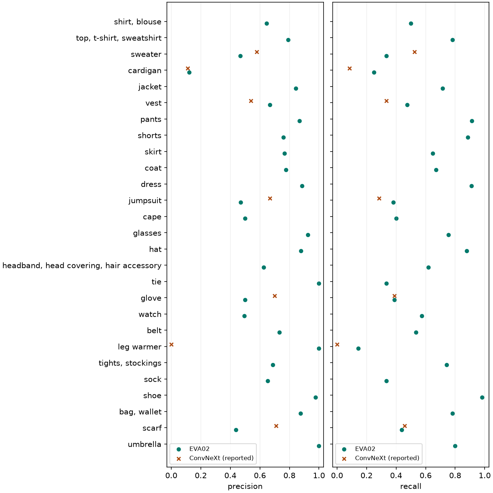

# EVA02-Small과 ConvNeXt-Tiny 비교 보고서

## 1. 비교 목적

같은 이미지와 F1 정의에서 두 사전학습 Backbone 및 Fine-tuning 설정을 비교했다. ConvNeXt 수치는 팀원이 보고한 실측치이며 EVA 수치는 이 PC에서 산출했다.

## 2. 통제 조건

고정 분할, 클래스 순서, 공통 전처리 원칙, 평가 코드, BCE·AdamW, 유효 배치 32, seed 42, 30 epoch 예산, warmup 5%, threshold 0.5와 holdout 선택 규칙을 맞췄다.

## 3. 모델별 차이

입력은 384 대 378, backbone LR은 1e-4 대 5e-5다. 공식 정규화, 사전학습 목적함수와 계산 장비도 다르다. [실제 설정 대조표](comparison_conditions.md)

## 4. 구조

ConvNeXt는 주변 영역의 패턴을 합성곱으로 학습하는 CNN이다. EVA02는 패치 간 관계를 학습하는 Vision Transformer다. 두 모델 모두 평균 풀링과 정규화 후 27개 점수를 낸다.

## 5–6. Holdout과 공식 Validation

| 분할 | 지표 | ConvNeXt | EVA02 | EVA−ConvNeXt |
|---|---|---:|---:|---:|
| holdout | micro_f1 | 0.805435 | 0.804340 | -0.001095 |
| holdout | macro_f1 | 0.707369 | 0.708463 | +0.001094 |
| holdout | image_f1 | 0.809035 | 0.804744 | -0.004291 |
| val | micro_f1 | 0.825538 | 0.811111 | -0.014427 |
| val | macro_f1 | 0.660754 | 0.632394 | -0.028360 |
| val | image_f1 | 0.827740 | 0.815633 | -0.012107 |

공식 Validation에서 Macro F1이 더 높은 쪽은 **ConvNeXt**다. EVA의 세 지표가 모두 낮았다.

## 7. 클래스별 기여

| 공식 Val 클래스 | 정답 | ConvNeXt F1 | EVA F1 | ΔF1 | ΔF1 / 27 |
|---|---:|---:|---:|---:|---:|
| sweater | 21 | 0.5500 | 0.3889 | -0.1611 | -0.005967 |
| sock | 51 | 0.6022 | 0.4416 | -0.1606 | -0.005950 |
| scarf | 48 | 0.5570 | 0.4375 | -0.1195 | -0.004425 |
| watch | 82 | 0.6043 | 0.5311 | -0.0732 | -0.002712 |
| glove | 18 | 0.5000 | 0.4375 | -0.0625 | -0.002315 |
| jumpsuit | 21 | 0.4000 | 0.4211 | +0.0211 | +0.000780 |
| cardigan | 12 | 0.0952 | 0.1622 | +0.0669 | +0.002479 |
| vest | 21 | 0.4118 | 0.5556 | +0.1438 | +0.005326 |
| leg warmer | 7 | 0.0000 | 0.2500 | +0.2500 | +0.009259 |

9/27개 클래스에서 기준 F1과 비교했다. 원자료의 반올림값만 있는 항목은 CSV에서 별도 표기했다. 기준 자료가 없는 항목을 제외했다. 이 표의 기여 합으로 전체 Macro 변화를 검증할 수 없다. FP가 늘면서 F1이 하락한 항목은 scarf (FP +18), glove (FP +4)다. FP 증가만으로 하락 전체를 설명할 수는 없다.

확인된 9개 클래스의 기여 합은 약 -0.003525다. 전체 Macro 차이에서 이 합을 빼면 나머지 18개의 합산 기여는 약 -0.024835다. 개별 클래스에 이 잔차를 배분할 자료는 없다.

## 8. 희귀 클래스 오류

leg warmer 정답 7장 중 ConvNeXt는 0장, EVA는 1장을 찾았다. FP는 각각 0개, 0개다. 이 표본에서는 TP 하나의 차이도 recall을 약 14.3%p 바꾼다. cardigan, jumpsuit, vest, glove 등은 위 표와 `class_f1_comparison.csv`의 TP/FP/FN을 함께 본다.

액세서리의 실제 FN 변화(ConvNeXt→EVA)는 scarf 26→27개, glove 11→11개, leg warmer 7→6개다.

## 9. 학습 곡선과 분포

ConvNeXt의 Holdout BCE 최소는 epoch 3, Macro 최대는 10, 종료는 15였다. EVA의 대응 시점은 3, 10, 15였다. EVA의 공식 Val − Holdout F1은 +0.006771 / -0.076068 / +0.010890였다. 성능 격차는 적은 양성 표본과 클래스 비율에도 영향을 받는다.

| Epoch | ConvNeXt Train / Hold BCE / Macro | EVA Train / Hold BCE / Macro |
|---:|---|---|
| 3 | 0.077381 / 0.139571 / 0.652264 | 0.087044 / 0.144301 / 0.654403 |
| 10 | 0.009334 / 0.252751 / 0.707369 | 0.018348 / 0.210548 / 0.708463 |
| 15 | 0.002751 / 0.321645 / 0.696809 | 0.006606 / 0.269694 / 0.700228 |

## 10. 계산 비용

| 측정 | ConvNeXt / RTX A5000 | EVA02 / RTX 4060 |
|---|---:|---:|
| 파라미터 | 27,840,891 | 21,813,147 |
| 누적 train 분 | 58.97 | 138.42 |
| 학습 peak allocated / reserved GB | 3.652 / 3.735 | 3.020 / 3.169 |
| 공식 val forward ms/장 | 2.666 | 4.073 |
| 로더 포함 ms/장 | 4.392 | 19.653 |

## 11. 공정성

한 seed에서 관측한 차이다. 반복 실행 변동, 크기가 작은 클래스의 불확실성, 장비 및 소프트웨어 차이가 남는다. 모델 구조만의 효과나 통계적 유의성을 판정할 근거는 없다.

## 12. 최종 Backbone 후보

이번 고정 설정에서 공식 Val Macro F1을 우선하면 ConvNeXt이다. 두 모델 모두 50M을 만족하며 EVA는 파라미터가 6,027,744개 적다. 배포 속도 기준의 최종 선택에는 동일 장비에서의 속도 측정이 필요하다.

## 13. 후속 비교 제안

후속으로는 공식 Val을 튜닝에 사용하지 않고 같은 Holdout에서 seed 변동을 확인하는 비교가 적절하다. 모델별 속도는 동일 장비·배치에서 재측정할 수 있다. 이번 실행은 고정된 기본 실험 한 번이다.
