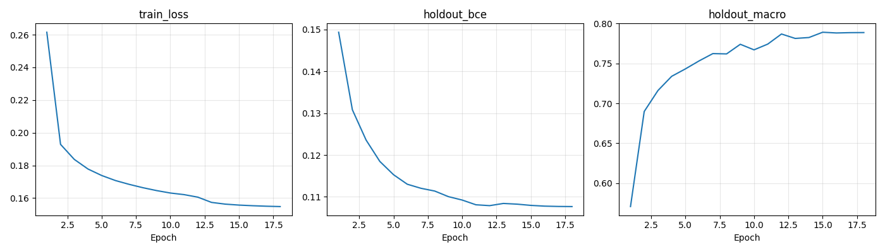

# R4_bce_kd_s42: BCE + 교사 증류 기준 실험

**18epoch 학습·holdout 및 공식 val 평가·보고서 생성 완료.** 학습은 2026-11-08 03:12:00 KST, 평가·보고서는 03:13:52 KST에 정상 종료했다. 모든 단계 종료 코드 0이며 AMP 업데이트 건너뜀은 누적 7회다. 상세 실행 기록은 [pipeline_status.json](results/logs/pipeline_status.json), [학습 로그](results/logs/train.log), [18epoch 이력](results/history.csv)에 보존했다.

## 목적과 구조

데이터 확대 라운드의 비교 기준을 만들기 위해 원본 Fashionpedia의 27개 의류·액세서리 다중 라벨을 학습했다. 팀 기준 R5_bce_kd_s42의 계획 설정을 역할4에서 구현한 실험이며 팀원 런타임과의 완전한 동일성은 확인하지 못했다.

ConvNeXt-Tiny(`convnext_tiny.fb_in22k_ft_in1k_384`)의 stride 16·32 특징 맵 각각에서 실제 이미지 영역만 masked GAP·GMP로 풀링한다. 두 스케일의 특징을 이어 LayerNorm → Linear로 분류하는 `linear_ms / gapgmp` 구조다. 패딩 영역은 풀링에서 제외한다. 총 파라미터는 27,853,563개다.

손실은 `0.5 × BCE(정답) + 0.5 × BCE(교사 soft target)`이다. FashionFormer 점수 p는 `sigmoid(logit(p) − logit(0.3))`로 이동해 교사의 0.3 기준을 0.5로 맞춘다. 교사 점수는 train_inner 43,197장에만 사용하며 holdout은 제외한다.

## 공통 조건과 선택 절차

| 항목 | 실제 조건 |
|---|---|
| 데이터 | train_inner 43,197 / holdout 2,425 / 공식 val 1,158 |
| 초기화 | timm pretrained, seed 42, 기존 C1 체크포인트 사용 없음 |
| 입력 | 학습 short 400~800 (실제 단계 416/544/672/800), max_long 1333, flip 0.5 |
| 학습 | 18epoch, batch 8 × accum 4, AdamW, backbone LR 1e-4 / head 1e-3 |
| 정규화 | weight decay .05, clip 1, head dropout .1, drop path .1, EMA .9995 |
| 스케줄 | warmup 1,000 updates, ratio .001, 2/3·11/12 시점 LR ×.1 |
| 추가 데이터·증강 | neg/pos/ext 입력 없음, mosaic/old/gray/zoom 꺼짐 |
| 환경 | torch 2.8.0+cu126, timm 1.0.22, AMP, workers 6 |

전체 실제 값은 [config.json](results/config.json), 사전 데이터·교사·환경 검증은 [preflight.json](checks/preflight.json)에 있다. 이 사전 기록의 미실행 상태 문구는 과거 스냅샷이며 현재 완료 상태는 위 실행 기록을 따른다. 소스 원본은 커밋 `913448df05ed436ae6f9357bf2c6faab461d7bc9`에서 고정했으며 [파일별 hash](source_manifest.json)를 보존했다.

best는 매 epoch의 **EMA holdout Macro F1 @0.5, TTA 없음**으로 선택해 **epoch 15**가 됐다. 이때 micro/macro/image F1은 **0.8720 / 0.7891 / 0.8687**이다. 총 학습 기록은 307.0분이다. 이후 best에 대해 short 800 / max_long 1333의 원본·수평 반전 **logits 평균 TTA**를 수행했다. holdout에서 전역 임계값 .05~.95를 .05 간격으로 탐색하고 Macro → Micro → 높은 임계값 순으로 결정했다. **0.4**, 단 sweater·leg warmer·umbrella는 **0.5**다. [selection.json](results/selection.json)에 체크포인트·설정·holdout 예측 hash를 고정한 뒤 공식 val을 평가했다. val로 모델·임계값을 선택하지 않았다.

## 최종 결과

| split | 이미지 수 | Micro F1 | Macro F1 | Image F1 |
|---|---:|---:|---:|---:|
| holdout (선택용) | 2,425 | 0.8707 | 0.7987 | 0.8720 |
| 공식 val | 1,158 | 0.8762 | 0.7378 | 0.8786 |

이 표는 위 TTA·선택 임계값을 적용한 최종 결과다. best epoch 선택 지표와 조건이 다르다. [상세 보고서 및 전체 27클래스 표](results/README.md), [holdout CSV](results/holdout_per_class.csv), [val CSV](results/val_per_class.csv), [holdout 원시 집계](results/holdout_metrics.json), [val 원시 집계](results/val_metrics.json)를 함께 제공한다.

그래프는 history.csv의 train_loss / holdout_bce / holdout_macro이며 epoch별 TTA 없는 @0.5 지표다. 최종 TTA 결과의 시계열로 해석하지 않는다. 공식 val의 leg warmer F1은 0.0000(support 7), cape 0.2857(support 5)로 희소 클래스에 한계가 있다. cape·tie·leg warmer·umbrella 제외 Macro F1은 holdout 0.8243, val 0.7824다.

## 비교 범위와 미완료 항목

- [기존 C1 BCE·ASL 비교](https://github.com/goeun-ctrl/fashion-tagging/blob/feature/role4-c1-bce-asl-results/experiments/role4_c1/README.md)는 다른 실험이다. 이번에는 증류·다중 스케일 GAP/GMP 구조가 추가돼 C1의 loss만 비교한 통제 조건과 다르다. C1에서 선택한 BCE를 새 조합에서 재검증했다거나 성능 차이가 loss 하나 때문이라고 주장하지 않는다. 기존 C1 산출물은 변경하지 않았다.
- OOD 진단(예시 micro, 군중/2~4명/1명 재현율, 라벨 수 오차, 테스트 유형별 예측 수·빈 예측)은 test_public·examples_labeled·유형별 image_tags.csv가 없어 **미완료**다. core 평가 완료와 구분한다.
- 교사의 사전학습 데이터 출처는 NPZ만으로 증명할 수 없다. 교사가 train2020 전체에 노출됐다면 holdout 사전 노출 가능성이 있다. 학생이 holdout 교사 점수를 학습에 사용하지 않은 검증과 별개다.
- 단일 seed, 희소 클래스 표본 수, holdout을 모델·임계값 선택에 쓴 한계가 있다. 후속 기준 모델과의 paired bootstrap 및 유의성 검정은 수행하지 않았다. 자기 자신과의 차이·신뢰구간은 보고하지 않는다.
- 원본 데이터·교사 NPZ·예측 NPZ·체크포인트·가상환경·인증 정보는 Git에 포함하지 않았다. 해시와 경로는 출처 기록이며 파일 자체는 별도 준비해야 한다.

## 재현

[재현 명령과 주의사항](REPRODUCE.md)을 따른다. 실제 실행 코드와 설정을 보존했으며 이번 게시 작업에서는 학습·평가를 다시 실행하지 않았다. [원래 보고서 생성 코드](report_results.py)는 로컬 runs/ 경로의 자동 생성 결과용이고, 이 README는 게시용 설명을 추가한 문서다.

게시본에서는 서버 절대경로·GPU UUID·PID·교사 파일의 예시 이미지 식별자를 가리고, 타인 GPU 프로세스 스냅샷은 제외했다. 수치·학습 조건·원본 hash는 보존했다. `selection.json`의 config_sha256는 원본 실행 설정의 hash이며 published_config_sha256는 경로를 가린 게시용 config의 hash다. 자동 처리 래퍼도 경로·GPU 식별자만 치환한 게시본이므로 원본 frozen_sha256와 직접 비교하지 않는다. 팀 source/ 원문 hash 검증은 유지한다.
