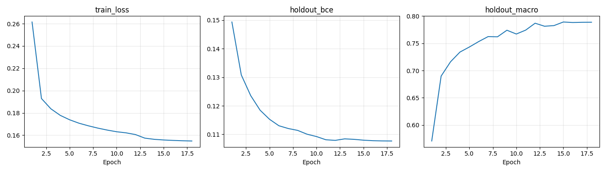

# R4_bce_kd_s42 최종 핵심 평가

원본 Fashionpedia, BCE + FashionFormer KD(alpha .5, shift .3), linear_ms + gapgmp. 팀 기준 R5_bce_kd_s42의 계획 설정을 따랐다. 팀원 실제 런타임과의 일치는 미검증이다. 기존 C1 BCE·ASL 비교와 별도이며 그 선택을 새 조합에서 재검증한 결과가 아니다.

best epoch: 15, 총 18epoch, 학습 307.0분. EMA holdout Macro F1 기준. 반전 logits 평균 TTA, holdout 선택 threshold **0.4**, sweater·leg warmer·umbrella는 .5. holdout selection.json을 저장한 뒤 공식 val을 평가했다.

| ID | 임계값 | holdout micro / macro / image | val micro / macro / image | 기준 대비 CI | 예시 micro / 군중 재현율 | 테스트 유형별 예측 수 |
|---|---|---|---|---|---|---|
| R4_bce_kd_s42 | 0.4 + 3개 .5 예외 | 0.8707 / 0.7987 / 0.8720 | 0.8762 / 0.7378 / 0.8786 | 해당 없음(기준 자체) | 자료 미확보 | 자료 미확보 |

## holdout 클래스별 결과

| category | support | precision | recall | F1 |
|---|---|---|---|---|
| shirt, blouse | 421 | 0.8525 | 0.8789 | 0.8655 |
| top, t-shirt, sweatshirt | 820 | 0.7635 | 0.8817 | 0.8183 |
| sweater | 123 | 0.8090 | 0.5854 | 0.6792 |
| cardigan | 114 | 0.7545 | 0.7281 | 0.7411 |
| jacket | 503 | 0.7871 | 0.9185 | 0.8477 |
| vest | 82 | 0.8462 | 0.6707 | 0.7483 |
| pants | 730 | 0.8727 | 0.9671 | 0.9175 |
| shorts | 216 | 0.8705 | 0.9028 | 0.8864 |
| skirt | 332 | 0.7585 | 0.8042 | 0.7807 |
| coat | 243 | 0.7042 | 0.9012 | 0.7906 |
| dress | 934 | 0.8534 | 0.9347 | 0.8922 |
| jumpsuit | 68 | 0.7544 | 0.6324 | 0.6880 |
| cape | 16 | 0.7500 | 0.3750 | 0.5000 |
| glasses | 405 | 0.9521 | 0.9333 | 0.9426 |
| hat | 254 | 0.9015 | 0.9370 | 0.9189 |
| headband, head covering, hair accessory | 265 | 0.8255 | 0.7321 | 0.7760 |
| tie | 142 | 0.9407 | 0.8944 | 0.9170 |
| glove | 83 | 0.8986 | 0.7470 | 0.8158 |
| watch | 304 | 0.8069 | 0.8520 | 0.8288 |
| belt | 490 | 0.8191 | 0.8041 | 0.8115 |
| leg warmer | 8 | 1.0000 | 0.2500 | 0.4000 |
| tights, stockings | 225 | 0.8403 | 0.8889 | 0.8639 |
| sock | 155 | 0.7372 | 0.6516 | 0.6918 |
| shoe | 1439 | 0.9807 | 0.9896 | 0.9851 |
| bag, wallet | 500 | 0.8970 | 0.9060 | 0.9015 |
| scarf | 150 | 0.8413 | 0.7067 | 0.7681 |
| umbrella | 20 | 1.0000 | 0.6500 | 0.7879 |

희소 4개 제외 Macro F1: 0.8243

## val 클래스별 결과

| category | support | precision | recall | F1 |
|---|---|---|---|---|
| shirt, blouse | 102 | 0.7117 | 0.7745 | 0.7418 |
| top, t-shirt, sweatshirt | 463 | 0.8136 | 0.9050 | 0.8569 |
| sweater | 21 | 0.7500 | 0.7143 | 0.7317 |
| cardigan | 12 | 0.3571 | 0.4167 | 0.3846 |
| jacket | 179 | 0.7734 | 0.8771 | 0.8220 |
| vest | 21 | 0.7143 | 0.4762 | 0.5714 |
| pants | 313 | 0.8919 | 0.9489 | 0.9195 |
| shorts | 106 | 0.7983 | 0.8962 | 0.8444 |
| skirt | 162 | 0.7000 | 0.8210 | 0.7557 |
| coat | 103 | 0.7787 | 0.9223 | 0.8444 |
| dress | 506 | 0.8780 | 0.9526 | 0.9137 |
| jumpsuit | 21 | 0.5000 | 0.5238 | 0.5116 |
| cape | 5 | 0.5000 | 0.2000 | 0.2857 |
| glasses | 130 | 0.9692 | 0.9692 | 0.9692 |
| hat | 74 | 0.9571 | 0.9054 | 0.9306 |
| headband, head covering, hair accessory | 105 | 0.8350 | 0.8190 | 0.8269 |
| tie | 3 | 0.6000 | 1.0000 | 0.7500 |
| glove | 18 | 0.7059 | 0.6667 | 0.6857 |
| watch | 82 | 0.7447 | 0.8537 | 0.7955 |
| belt | 159 | 0.7310 | 0.7862 | 0.7576 |
| leg warmer | 7 | 0.0000 | 0.0000 | 0.0000 |
| tights, stockings | 62 | 0.7703 | 0.9194 | 0.8382 |
| sock | 51 | 0.7115 | 0.7255 | 0.7184 |
| shoe | 804 | 0.9828 | 0.9938 | 0.9882 |
| bag, wallet | 205 | 0.8900 | 0.9073 | 0.8986 |
| scarf | 48 | 0.7111 | 0.6667 | 0.6882 |
| umbrella | 5 | 1.0000 | 0.8000 | 0.8889 |

희소 4개 제외 Macro F1: 0.7824

교사 매칭·코드·분할·라이브러리 기록은 [사전 검증](../checks/preflight.json) 및 [소스 목록](../source_manifest.json), 초기 가중치 hash는 [initialization.json](initialization.json)에 있다. 원본 데이터·교사·test 데이터는 Git에 올리지 않는다.

OOD 진단은 자료 미확보로 미완료다. val·테스트로 설정을 수정하거나 모델을 선택하지 않았다. 자기 자신과의 차이·bootstrap은 만들지 않았다. 향후 쌍 비교용 filenames·targets·categories·logits는 로컬 runs/의 NPZ에만 보존하며 Git에는 포함하지 않았다. 단일 seed이며 후속 차이의 신뢰구간이 0을 포함하면 “유의한 차이를 확인하지 못함”으로 표현한다.
