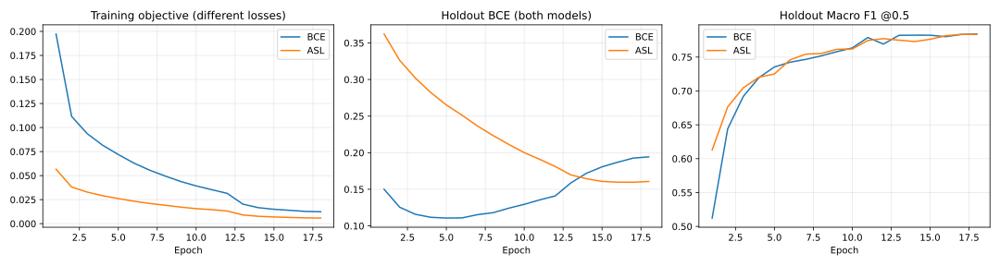

# C1 고해상도 ConvNeXt: BCE·ASL 최종 비교

2026-11-07 20:43(KST) 공식 val 평가·비교 완료. **사전 holdout 기준에 따라 BCE 잠정 선택**, 단일 seed에서 Macro F1의 확정적 우열은 확인하지 못했다.

목적은 고해상도 ConvNeXt C1에서 Loss만 BCE와 ASL로 바꾼 대조 비교다. **원본 Fashionpedia만 사용**했다. 외부 데이터, 증류, gate, 후속 헤드, 모자이크·zoom-out·옛날 사진 증강은 제외했다.

## 공통 조건과 선택 규칙

- 모델: `convnext_tiny.fb_in22k_ft_in1k_384`, stride32 Masked GAP + Linear(27), 27,840,891 parameters.
- 분할: train_inner 43,197 / holdout 2,425 / 공식 val 1,158. 저장소 `data/splits/` 고정 목록과 원본 라벨 사용.
- seed42, 공통 초기 파일 SHA256 `a83561ececb61894b28716994f5db54b9103f594c6330875dd5fae80959da653`. 모델 상태 SHA256 `c83851550e619511e0b179edf075690c11552c45113678fb368582a0e0c51a13`. 초기화는 CPU에서 한 번 생성, 양쪽 strict load. 체크포인트와 초기 가중치 자체는 Git에 포함하지 않는다.
- 입력: 비율 유지, 학습 짧은 변 실제 단계 416/544/672/800, 좌우 반전 .5, 평가 800/1333. 정규화 후 0 padding, 실제 영역만 pooling.
- AdamW backbone lr 1e-4 / fc lr 1e-3, wd .05, clip1, batch8 × accum4, 18epoch, warmup1000, 2/3·11/12에서 lr ×.1, drop path .1, EMA .9995(use_warmup=True), AMP.
- BCE는 logits BCE, ASL은 gamma_neg4 / gamma_pos0 / clip.05. 동일한 known-label 평균 reduction.
- best epoch: EMA holdout Macro F1 @.5/no-TTA 최대. BCE epoch18, ASL epoch17. Loss 선택도 이 기본 holdout 기준만 사용한다.
- tuned: holdout Macro F1로 전역 threshold .05~.95, 간격 .05 탐색. TTA는 원본·좌우 반전 logits 평균 후 sigmoid. TTA 임계값은 별도로 holdout에서 선택. val에서는 선택을 변경하지 않았다.
- 실제 실행: A5000 1장씩 BCE GPU3 / ASL GPU0 병렬, 331.8 / 333.3분. GPU smoke 및 체크포인트 재로딩 통과.
- 환경: Python3.12.3, torch2.8.0+cu126, torchvision0.23.0+cu126, timm1.0.22, numpy2.2.6, Pillow11.3.0. 정확한 [설정](settings.json), [실행 완료 기록](results/pipeline_status.json), [GPU 검사](results/gpu_checks.json).

## 기본·후처리 비교

baseline=.5/no-TTA, tuned=holdout threshold/no-TTA, tta_05=.5/flip TTA, tta_tuned=holdout threshold/flip TTA. 아래 표는 CSV에서 자동 생성한다.

### Holdout (선택용)

| loss | mode | threshold | macro_f1 | micro_f1 | image_f1 |
| --- | --- | --- | --- | --- | --- |
| bce | baseline | 0.5000 | 0.7841 | 0.8572 | 0.8520 |
| bce | tuned | 0.1500 | 0.7888 | 0.8546 | 0.8541 |
| bce | tta_05 | 0.5000 | 0.7823 | 0.8602 | 0.8550 |
| bce | tta_tuned | 0.2500 | 0.7939 | 0.8604 | 0.8583 |
| asl | baseline | 0.5000 | 0.7835 | 0.8472 | 0.8484 |
| asl | tuned | 0.6500 | 0.7848 | 0.8562 | 0.8529 |
| asl | tta_05 | 0.5000 | 0.7820 | 0.8497 | 0.8515 |
| asl | tta_tuned | 0.5500 | 0.7843 | 0.8536 | 0.8540 |

### 공식 val (보고 전용)

| loss | mode | threshold | macro_f1 | micro_f1 | image_f1 |
| --- | --- | --- | --- | --- | --- |
| bce | baseline | 0.5000 | 0.7361 | 0.8702 | 0.8670 |
| bce | tuned | 0.1500 | 0.7516 | 0.8648 | 0.8648 |
| bce | tta_05 | 0.5000 | 0.7376 | 0.8695 | 0.8660 |
| bce | tta_tuned | 0.2500 | 0.7587 | 0.8740 | 0.8731 |
| asl | baseline | 0.5000 | 0.7404 | 0.8558 | 0.8593 |
| asl | tuned | 0.6500 | 0.7352 | 0.8657 | 0.8655 |
| asl | tta_05 | 0.5000 | 0.7453 | 0.8579 | 0.8619 |
| asl | tta_tuned | 0.5500 | 0.7532 | 0.8628 | 0.8657 |

## 차이의 신뢰구간과 선택 해석

차이는 ASL−BCE. 이미지 단위 쌍 부트스트랩 2,000회, seed42, percentile 95% 구간이다. 모델과 임계값을 고정한 조건부 구간으로 학습 seed 변동과 holdout 선택 불확실성은 포함하지 않는다. 다중 비교 보정은 하지 않았으며 단일 seed의 작은 차이를 일반적 Loss 우열로 해석하지 않는다.

Holdout 기본 Macro F1 차이는 −0.0005, 95% CI [−0.0155, +0.0169]로 0을 포함한다. BCE 선택은 사전 규칙에 따른 잠정 결정이다. 공식 val에서도 모든 모드의 Macro F1 차이 구간이 0을 포함한다. TTA+tuned의 Micro·Image F1은 BCE 쪽이 높고 해당 구간은 0을 포함하지 않는다.

공식 val 전체 지표의 차이와 구간:

| mode | metric | delta | ci_low | ci_high |
| --- | --- | --- | --- | --- |
| baseline | macro_f1 | 0.0043 | -0.0259 | 0.0352 |
| baseline | micro_f1 | -0.0144 | -0.0211 | -0.0074 |
| baseline | image_f1 | -0.0077 | -0.0150 | 0.0001 |
| tuned | macro_f1 | -0.0164 | -0.0495 | 0.0117 |
| tuned | micro_f1 | 0.0009 | -0.0054 | 0.0071 |
| tuned | image_f1 | 0.0006 | -0.0063 | 0.0073 |
| tta_05 | macro_f1 | 0.0078 | -0.0209 | 0.0370 |
| tta_05 | micro_f1 | -0.0115 | -0.0181 | -0.0041 |
| tta_05 | image_f1 | -0.0041 | -0.0116 | 0.0040 |
| tta_tuned | macro_f1 | -0.0055 | -0.0320 | 0.0199 |
| tta_tuned | micro_f1 | -0.0112 | -0.0172 | -0.0049 |
| tta_tuned | image_f1 | -0.0074 | -0.0137 | -0.0006 |

## 공식 val 27개 클래스와 희소 클래스 변화

기본 .5/no-TTA F1, delta=ASL−BCE. 희소 7개는 cardigan, vest, jumpsuit, cape, glove, leg warmer, umbrella이며 rare 열로 표시했다. 양성이 적은 클래스의 변동을 평균적인 개선으로 단정하지 않는다. 모든 후처리 조건의 Precision·Recall은 [27개 클래스 CSV](results/val/per_class.csv)와 [희소 7개 CSV](results/val/rare_classes.csv)에 있다.

| category | rare | support | bce_f1 | asl_f1 | delta |
| --- | --- | --- | --- | --- | --- |
| shirt, blouse | False | 102 | 0.7047 | 0.7143 | 0.0096 |
| top, t-shirt, sweatshirt | False | 463 | 0.8453 | 0.8345 | -0.0108 |
| sweater | False | 21 | 0.6364 | 0.5556 | -0.0808 |
| cardigan | True | 12 | 0.3158 | 0.4375 | 0.1217 |
| jacket | False | 179 | 0.7955 | 0.7846 | -0.0109 |
| vest | True | 21 | 0.6154 | 0.4583 | -0.1571 |
| pants | False | 313 | 0.9176 | 0.9154 | -0.0022 |
| shorts | False | 106 | 0.8406 | 0.8387 | -0.0019 |
| skirt | False | 162 | 0.7634 | 0.7514 | -0.0120 |
| coat | False | 103 | 0.7921 | 0.7895 | -0.0026 |
| dress | False | 506 | 0.9279 | 0.9136 | -0.0143 |
| jumpsuit | True | 21 | 0.5294 | 0.4400 | -0.0894 |
| cape | True | 5 | 0.8889 | 0.6667 | -0.2222 |
| glasses | False | 130 | 0.9609 | 0.9403 | -0.0206 |
| hat | False | 74 | 0.8905 | 0.9007 | 0.0102 |
| headband, head covering, hair accessory | False | 105 | 0.7876 | 0.7672 | -0.0203 |
| tie | False | 3 | 0.7500 | 0.7500 | 0.0000 |
| glove | True | 18 | 0.5455 | 0.6667 | 0.1212 |
| watch | False | 82 | 0.7821 | 0.7701 | -0.0119 |
| belt | False | 159 | 0.7607 | 0.7514 | -0.0092 |
| leg warmer | True | 7 | 0.0000 | 0.4000 | 0.4000 |
| tights, stockings | False | 62 | 0.8333 | 0.7714 | -0.0619 |
| sock | False | 51 | 0.6136 | 0.6055 | -0.0081 |
| shoe | False | 804 | 0.9857 | 0.9839 | -0.0017 |
| bag, wallet | False | 205 | 0.8872 | 0.8744 | -0.0128 |
| scarf | False | 48 | 0.6154 | 0.7083 | 0.0929 |
| umbrella | True | 5 | 0.8889 | 1.0000 | 0.1111 |

## 학습 곡선·과적합·Precision/Recall



BCE와 ASL의 train loss는 목적함수가 달라 절대 크기를 직접 비교하지 않는다. 공통 holdout BCE 손실은 BCE 모델에서 초반 최저점 이후 상승하는 반면 train loss는 계속 감소한다. 이는 확률 예측 손실 관점의 과적합 징후다. 다만 holdout Macro F1은 후반까지 개선되어 BCE epoch18이 선택됐다. ASL은 epoch17 이후 Macro F1이 소폭 하락했다. 손실 상승만으로 분류 F1 악화를 단정하지 않는다.

기본 val Micro Precision/Recall은 BCE .8890/.8521, ASL .8155/.9002다. ASL은 더 많은 양성을 찾아 Recall이 높지만 오탐도 늘어 Precision이 낮다. 임계값 조정 후 차이가 달라지므로 기본 Loss 효과와 후처리 효과를 구분한다. 각 조건 전체 Precision/Recall은 [상세 보고서](results/report.md)에 있다.

## 재현과 결과 위치

[재현 절차와 명령](methodology.md)을 저장소 루트에서 실행한다. 해당 문서에는 이번 비교의 초기화·학습·평가 명령만 담았다. `settings.json`의 train_dir/val_dir/splits_dir는 각 머신의 원본 데이터 경로로 두 Loss에 동일하게 변경한다. CPU 초기화 → 양쪽 18epoch → holdout 평가/선택 lock → 공식 val 평가/비교 순서를 지킨다. 기존 실행 폴더는 덮어쓰지 않으므로 새 checkout 또는 비어 있는 출력 경로를 사용한다. `role4_c1_run.py`/`parallel_role4_c1.py`는 당시 GPU UUID를 고정한 실행 기록이므로 다른 머신에서는 수동 재현 명령을 사용한다.

```bash
python -m pip install torch==2.8.0 torchvision==0.23.0 --index-url https://download.pytorch.org/whl/cu126
python -m pip install timm==1.0.22 numpy==2.2.6 Pillow==11.3.0 matplotlib
# 실제 init/train/evaluate/compare 명령은 위 재현 절차 링크 참조
python scripts/share_role4_c1.py
python scripts/share_role4_c1.py --check
```

새로 생성한 초기 파일의 직렬화 SHA는 환경에 따라 달라질 수 있다. 모델·head 상태 hash, 라이브러리, 데이터 및 sampler hash를 비교한다. GPU 비결정적 커널 때문에 다른 환경에서 bitwise 일치를 보장하지 않는다. 원본 데이터와 timm pretrained weight는 별도로 확보해야 한다.

공유 결과는 `results/{holdout,val}/`의 summary/comparison/per_class/rare_classes CSV, bootstrap JSON 및 holdout selection lock이다. `results/{bce,asl}/`에는 history/config/summary가 있다. [상세 결과](results/report.md), [holdout 선택](results/holdout/selection.json), [val 신뢰구간 원본](results/val/bootstrap.json), [BCE history](results/bce/history.csv), [ASL history](results/asl/history.csv)를 참조한다. 원래 실행 산출물은 `runs/role4_c1/`, 원래 보고서는 `report/role4_c1_*`다. Git에는 원본 이미지·라벨·예측 배열·체크포인트·가상환경·인증 정보를 포함하지 않는다.
